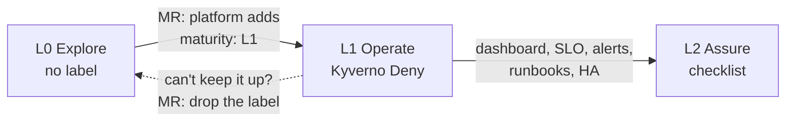

# 0. Levels: how production-ready your namespace is

← [App teams](README.md) · next: [1. Metrics](1-metrics.md) · design: [ADR 0006](../decisions/0006-maturity-levels.md)

A **maturity level** says what a namespace promises to the people who depend on it, and which rules the platform enforces there. Start at L0, move up when the app has users to protect.

| Level | Name | Promise | For | Enforced |
|---|---|---|---|---|
| **L0** | Explore | None: it may break, and nobody is paged | a new team proving an idea fast | nothing |
| **L1** | Operate | The team can see it, run it and be found when it breaks | anything with real users | Kyverno, at admission |
| **L2** | Assure | It meets a stated SLO, and the team is alerted before users notice | critical services | not yet: checklist |



## Why levels
- **L0 is cheap on purpose.** A POC shouldn't need probes and on-call to get started. Nothing blocks it.
- **L1 is the bar for production.** Below it, an incident is guesswork: no metrics, no health signal, no idea who owns it. Every L1 rule answers one question the on-call engineer will ask.
- **L2 is for the services that must not fail.** Its items live on the hub (dashboards, alerts), where admission can't see them, so it's a checklist for now.
- **Levels describe the namespace, not the environment.** A dev cluster can host an L1 namespace; a POC on a prod cluster is still L0.

## What each level requires
| Requirement | Answers | L0 | L1 | L2 | Checked by | Exemption |
|---|---|---|---|---|---|---|
| Namespace label `starlab-platform/team` + annotation `starlab-platform/contact` | Who do I page? | — | ✅ | ✅ | `require-owner` | none |
| Container port named `metrics` ([1. Metrics](1-metrics.md)) | What is it doing? | optional | ✅ | ✅ | `require-metrics-port` | `starlab-platform/metrics-exempt` |
| `readinessProbe` + `livenessProbe` on every container | Is it healthy? | — | ✅ | ✅ | `require-probes` | `starlab-platform/probes-exempt` |
| `requests.cpu`, `requests.memory`, `limits.memory` on every container | Will it fit, and can it starve its neighbours? | — | ✅ | ✅ | `require-resources` | none |
| RED + business metrics emitted | Is it working for users? | — | ✅ | ✅ | review | — |
| Team dashboard in ACM Grafana ([2. Dashboard](2-dashboards.md)) | Where do I look? | — | — | ✅ | checklist | — |
| SLO on RED metrics + multi-window burn-rate alerts to the contact | Are we about to break a promise? | — | — | ✅ | checklist | — |
| `runbook_url` on every alert | What do I do now? | — | — | ✅ | checklist | — |
| `replicas ≥ 2` + a PodDisruptionBudget | Does a node drain take it down? | — | — | ✅ | checklist | — |

- Policies: `platform-tools/acm/spoke-clusters/kyverno/l1-policies.yaml`, one per rule, all `Deny`, on pods (not Deployments) in namespaces labelled `starlab-platform/maturity: L1`.
- Init containers aren't checked. A CPU limit is optional: it throttles, a memory limit protects.
- Exemptions are per pod, per rule, and need a reason: `starlab-platform/probes-exempt: "load generator, serves nothing"`. Only pods with nothing to serve (load generators, one-shot jobs) qualify.

## Move to L1
1. **Meet the rules** in your manifests. Example: `platform-tools/acm/spoke-clusters/spoke-1/apps.yaml`.
   ```yaml
   kind: Namespace
   metadata:
     name: my-app
     labels: {starlab-platform/maturity: L1, starlab-platform/team: my-team}
     annotations: {starlab-platform/contact: "#my-team-oncall"}
   ---
   # in every container
   ports: [{name: metrics, containerPort: 9898}]
   readinessProbe: {httpGet: {path: /readyz, port: metrics}}
   livenessProbe: {httpGet: {path: /healthz, port: metrics}}
   resources: {requests: {cpu: 10m, memory: 32Mi}, limits: {memory: 64Mi}}
   ```
2. **Dry-run against the cluster** before asking. Admission runs, nothing is created:
   ```sh
   oc apply --dry-run=server -k <your-app>
   ```
3. **Open an MR** adding `starlab-platform/maturity: L1` to the namespace. The platform team reviews and merges it; that MR is the gate.
4. **From then on**, a pod that breaks a rule is rejected. Its Deployment rolls out but gets no new pods:
   ```sh
   oc get events -n <ns> --field-selector reason=FailedCreate
   ```

## Move to L2
Not enforced yet. Tick every L2 row above in your MR description, and ask the platform team to review it. Until L2 has its own label, the namespace stays `L1`.

## When the rules change
- **New L1 rules ship as `Warn` first:** the warning shows up in `oc apply` and ArgoCD, and nothing is rejected. They become `Deny` after the date announced with them.
- **Can't keep L1?** Open an MR to drop the label. Going back to L0 is fine; staying at L1 with exemptions you can't justify isn't.

## Check it
| What | How |
|---|---|
| Your namespace's level | `oc get ns <ns> -L starlab-platform/maturity,starlab-platform/team` |
| Every L1 namespace on a spoke | `oc get ns -l starlab-platform/maturity=L1` |
| Policies allow and deny as documented | `./platform-tools/acm/spoke-clusters/check-policies.sh [spoke-N]` |
| L1 pods have their metrics on the hub | `./platform-tools/acm/spoke-clusters/check-metrics.sh` |
