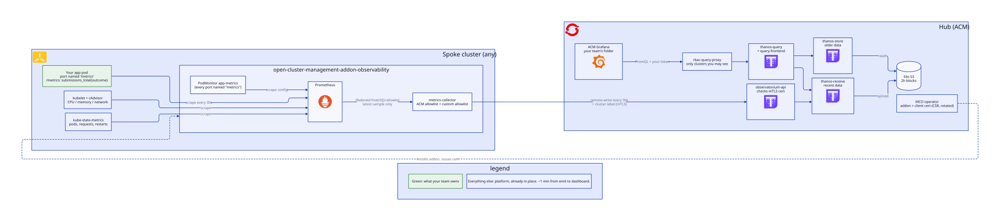

# 1. Metrics: get your app's metrics to the hub

← [App teams](README.md) · next: [2. Dashboard](2-dashboards.md) · design: [ADR 0004](../decisions/0004-per-pod-app-metrics.md)



- **Free, no action needed:** CPU, memory, network, restarts and replicas for every pod (cAdvisor, kube-state-metrics).
- **Your metrics:** serve Prometheus `/metrics` on a container port named `metrics`. The platform scrapes it and forwards everything to the hub within ~1 min. No ServiceMonitor or PodMonitor needed.

## Levels
| | L0: spike, POC | L1: scale, maintain |
|---|---|---|
| Namespace label | none | `golden-path.level: L1` |
| `metrics` port | optional | **required**, enforced at admission by Kyverno |
| What to emit | anything | RED (rate, errors, duration) + your business metrics |
| Off-the-shelf software (nginx, redis, …) | — | exporter sidecar on the `metrics` port |
| Pods with nothing to expose | — | `golden-path/metrics-exempt: "<reason>"` annotation |

## Onboard to L1
1. **Name the port:**
   ```yaml
   ports: [{name: metrics, containerPort: 9898}]
   ```
   Example: `platform-tools/acm/spoke-clusters/spoke-1/apps.yaml` (podinfo).
2. **No native metrics?** Put the `metrics` port on an exporter sidecar:
   ```yaml
   - name: exporter
     image: oliver006/redis_exporter:v1.67.0
     ports: [{name: metrics, containerPort: 9121}]
   ```
   Examples: `spoke-2/apps.yaml` (redis, and nginx via `stub_status`).
3. **Emit RED:** a request duration histogram labelled `path`, `method`, `status`. Its `_count` gives traffic and errors, and its `_bucket` gives latency. Example: podinfo's `http_request_duration_seconds`.
4. **Exempt only what has nothing to expose** (load generators, one-shot jobs):
   ```yaml
   annotations: {golden-path/metrics-exempt: "busybox load generator, no metrics to expose"}
   ```
5. **Label the namespace** `golden-path.level: L1`. From then on, a pod without a `metrics` port is rejected:
   ```
   golden-path L1: expose a container port named "metrics", or annotate the pod with golden-path/metrics-exempt: "<reason>".
   ```

## Business metrics (success, failure, backlog)
| You want to know | Emit | Example |
|---|---|---|
| How many happened, and how many failed | **counter** with an `outcome` label | `submissions_total{outcome="success"}` |
| How long they took | **histogram** in seconds | `submission_duration_seconds` |
| How many are in flight or queued now | **gauge** | `submissions_in_progress` |

```python
from prometheus_client import Counter, Histogram, start_http_server

SUBMISSIONS = Counter("submissions_total", "Submissions processed, by outcome.", ["outcome", "reason"])
DURATION = Histogram("submission_duration_seconds", "Time to process a submission.")
SUBMISSIONS.labels("failure", "validation")   # pre-create: failures show 0, not "No data"

start_http_server(9898)                       # the container port named "metrics"

@DURATION.time()
def submit(form):
    try:
        process(form)
        SUBMISSIONS.labels("success", "").inc()
    except ValidationError:
        SUBMISSIONS.labels("failure", "validation").inc()
        raise
```

## Rules
- **Counters, not gauges, for "how many":** they survive restarts.
- **One metric with an `outcome` label**, not `_success_total` and `_failure_total`. The success rate is then one ratio.
- **Bounded labels only:** outcome, a reason from a fixed list, path, method, status. Never user or request IDs, emails, raw URLs or error messages. Every value is a new series stored on the hub (~1k per spoke today).
- **Units in the name:** `_seconds`, `_bytes`, `_total`.
- **One `metrics` port per pod.** With sidecars, put it on the exporter.
- **Custom paths, intervals or relabelling** aren't supported yet; ask the platform team.

## Check it arrived
- **In Grafana → Explore:** `sum by (cluster, namespace) (rate(submissions_total[5m]))`.
- **Is your pod scraped?** `up{job="open-cluster-management-addon-observability/app-metrics", namespace="<ns>"}`:
  - `1` = scraped;
  - `0` = there's a port named `metrics`, but it isn't serving plain `/metrics`.
