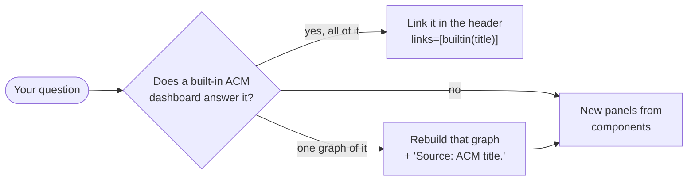

# 2. Dashboard: write it as Python

← [1. Metrics](1-metrics.md) · next: [3. Ship](3-ship.md) · design: [ADR 0005](../decisions/0005-dashboards-as-code.md)

- **Where:** `platform-tools/grafana/dashboards/<team>/<name>.py`. `sensor-team-1/system_a.py` → `/d/sensor-team-1-system-a`, in Grafana folder `sensor-team-1`.
- **How:** ask the `grafana-dashboard` skill a question, e.g. *"Is my CPU limit slowing my requests?"*. It composes the `.py` from the component library (`components/`). Or write it yourself; the rules are below.
- **Copy the shape of** `sensor-team-1/system_a.py` (team) or `starforge/platform_health.py` (fleet).


- Built-in catalog, readable offline: [`acm-builtin.md`](../../platform-tools/grafana/dashboards/acm-builtin.md). Never edit a built-in.

## Page structure (every dashboard; conformance fails without it)
```
System Vitals    standard RED + saturation tiles, then yours    vitals(...)
Golden Signals   Latency | Traffic, then Errors | Saturation    golden_signals(latency=[], traffic=[], errors=[], saturation=[])
                 each quadrant opens with its standard graph
Extensions       collapsed rows, one per question; team metrics extension("<question>?", ...)
```
- **The top half is the same on every page.** `vitals()` and `golden_signals()` always add the standard panels: Requests/s, 5xx rate, p95 latency (from `http_request_duration_seconds`) and memory / limit. You add to them; you can't replace them.
- **No histogram, blank panels.** If your app doesn't emit `http_request_duration_seconds` yet, the RED panels are empty and say why. Emit it ([1. Metrics](1-metrics.md)); don't fill them with something else.
- **Layout is automatic:** every line fills the width, with at most 4 graphs or tables per line.
- **Quadrants:** 1–3 graphs each. Side-by-side quadrants need counts that wrap alike (3 + 3 or 2 + 1, not 3 + 1).

## Where your metric goes
| It answers | Put it in |
|---|---|
| `http_request_duration_seconds`, sliced further (p95 by path) | the matching Golden Signals quadrant, after the standard graph |
| A platform metric: "is it OK right now?" (throttling, restarts) | a Vitals `tile`, or a quadrant |
| Your own metric (`submissions_total`, any gauge) | an `extension` titled with its question; conformance fails it anywhere above |

```python
ALL = per_pod(f'rate(submissions_total{{{C}, {APP}}}[{RATE}])')
OK  = per_pod(f'rate(submissions_total{{{C}, {APP}, outcome="success"}}[{RATE}])')
BAD = per_pod(f'increase(submissions_total{{{C}, {APP}, outcome="failure"}}[{RANGE}])')

vitals(), golden_signals(),  # the standard top half
extension("Why do submissions fail?",
          tile("Submission success", "Share that succeed. Low: see the graphs beside it.",
               ratio(f"sum({OK})", f"sum({ALL})"), PERCENT, NEUTRAL),
          graph("Submissions by outcome", "Per second, by outcome.", REQPS, (f"sum by (cluster, outcome) ({ALL})", "{{cluster}} {{outcome}}")),
          grid("Failures by reason", "In the selected range.", ("Failures", f"sum by (cluster, workload, reason) ({BAD})", COUNT, PROBLEMS)))
```

## Rules (`uv run pytest` fails on most of these; full list in [3. Ship](3-ship.md#what-conforms-to-the-golden-path-means))
- **Filters:** every panel follows cluster → node → namespace → workload → pod.
  - Wrap per-pod metrics in `per_pod(...)`, and node metrics in `per_node(...)`.
  - A metric with neither label ends its description with `CLUSTER_ONLY`.
- **Open on your namespace:** `dashboard(..., scope={"namespace": "<ns>"})`.
- **Time windows:**
  - graphs and tiles use `[{RATE}]` (1-minute points, widening on zoom);
  - tables use `[{RANGE}]` (the selected range);
  - sizing panels use `sizing=True` (fixed 7 days);
  - for a peak over the range, use `peak(...)`.
  - Never hard-code `[5m]`.
- **Colour:** pick a threshold set (`UTILISATION`, `PROVISIONING`, `ERRORS`, `THROTTLING`, `LATENCY`, `PROBLEMS`, `NEUTRAL`), never a colour.
- **Units:** pick a constant (`PERCENT`, `CORES`, `BYTES`, `BPS`, `PPS`, `SECONDS`, `REQPS`, `COUNT`). Ratios are 0–1.
- **Descriptions:** every panel says what it shows and what to do when it's red.
- **Legends:** include `{{cluster}}`.
- **Title:** `<Team> - <Scope>`.
- **Names are forever:** renaming a folder or file changes the URL.
