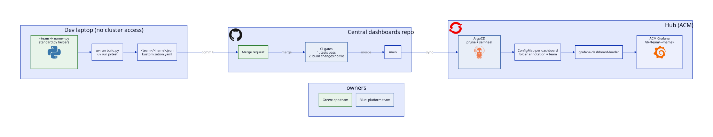
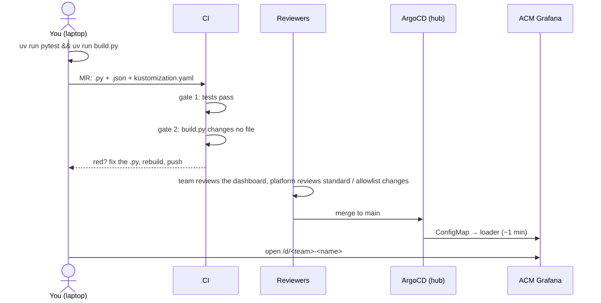

# 3. Ship: MR → CI → ArgoCD → Grafana

← [2. Dashboard](2-dashboards.md) · [App teams](README.md)





Commands, run from `platform-tools/grafana/dashboards`. The first run installs everything through uv:
```bash
uv run pytest      # the standard: layout, filters, windows, units, built-in links
uv run build.py    # writes <team>/<name>.json and kustomization.yaml; commit both
```

| CI fails on | Means | Fix |
|---|---|---|
| Gate 1: tests pass | The dashboard breaks a rule; the message names the panel | Fix the `.py` |
| Gate 2: `build.py` changes no file | You didn't build before committing, edited a `.json` by hand, or deleted a `.py` but kept its `.json` | `uv run build.py`, commit the result |

- **Remove a dashboard:** delete its `.py`, rebuild, and merge. Argo prunes the ConfigMap and Grafana drops it.
- **Never edit in the Grafana UI:** it's overwritten on the next sync.
- **Empty panel after merge?** Usually no events (no 5xx, no restarts), a filter that excludes your namespace, or an expired login (sign in again).
