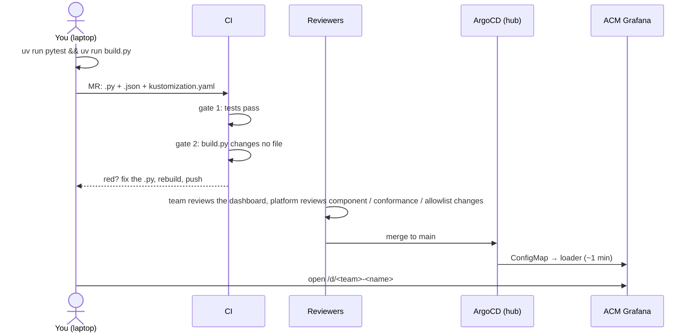
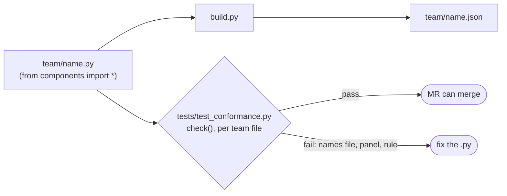

# 3. Ship: MR → CI → ArgoCD → Grafana

← [2. Dashboard](2-dashboards.md) · [App teams](README.md)




Commands, run from `platform-tools/grafana/dashboards`. The first run installs everything through uv:
```bash
uv run pytest      # conformance: your dashboard follows the golden path (structure, layout, filters, windows, units, links)
uv run build.py    # writes <team>/<name>.json and kustomization.yaml; commit both
```

## What "conforms to the golden path" means
**Your dashboard conforms when `tests/test_conformance.py` passes on it.** The test renders each committed `<team>/<name>.py` and runs `check()` on the JSON, one test per file: `test_team_dashboard_conforms[<team>/<name>.py]`. CI gate 1 runs it on every MR, so a dashboard that doesn't conform can't merge.


- **`build.py` doesn't check.** It writes the JSON whether or not it conforms, so run `uv run pytest` before you push.

| Checked | Rule |
|---|---|
| Page | title, description, `golden-path` tag; the five standard filters only |
| Structure | `vitals(...)`, then `golden_signals(...)`, then collapsed `extension(...)` rows only |
| Standard panels | Vitals and each Golden Signals quadrant open with the standard RED + saturation panels, unchanged; no title repeats |
| Team metrics | metrics scraped through `APP`, other than `http_request_duration_seconds`, only in extensions |
| Layout | every line fills the width; at most 4 graphs or tables per line |
| Panel | description; unit (tables exempt); a window in the title is fixed with `sizing=True` |
| Query | filters on `$cluster`; slices on `$pod`/`$node`, or the description ends with `CLUSTER_ONLY` |
| Time | graphs and tiles: 1m step, `[$__rate_interval]`; tables and sizing panels: `[$__range]`; subqueries only through `peak()` |
| Links | `builtin()` and `Source: ACM …` name a dashboard in `acm-builtin.md` that has data |

- **Rules check the output, not how you wrote it.** Hand-written PromQL passes if it follows the rules, but the helpers get you there without the work.
- **Not checked, so reviewers look:** whether the panels answer your question, and whether the metrics exist on the hub (`check-queries.sh`, platform-run).

| CI fails on | Means | Fix |
|---|---|---|
| Gate 1: tests pass | `test_team_dashboard_conforms[<team>/<name>.py]` is red: the dashboard breaks a rule; the message names the panel | Fix the `.py` |
| Gate 2: `build.py` changes no file | You didn't build before committing, edited a `.json` by hand, or deleted a `.py` but kept its `.json` | `uv run build.py`, commit the result |

- **Remove a dashboard:** delete its `.py`, rebuild, and merge. Argo prunes the ConfigMap and Grafana drops it.
- **Never edit in the Grafana UI:** it's overwritten on the next sync.
- **Empty panel after merge?** Usually no events (no 5xx, no restarts), a filter that excludes your namespace, or an expired login (sign in again).
