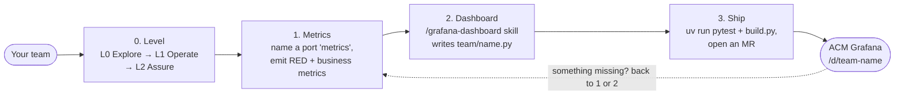

# App teams: from your app to your dashboard

You build it, you run it. Your app runs on a spoke; your metrics and dashboard show up in ACM Grafana on the hub. You never need cluster access to the hub.

| Step | Page | You do | Time |
|---|---|---|---|
| 0 | [Levels](0-levels.md) | Pick your level; for L1, add owner, probes and resources, then an MR for the label | once per namespace |
| 1 | [Metrics](1-metrics.md) | Expose `/metrics`; add business counters like `submissions_total{outcome}` | once per app |
| 2 | [Dashboard](2-dashboards.md) | Ask the skill a question; it writes the `.py` | minutes |
| 3 | [Ship](3-ship.md) | Build, commit, open an MR; CI and ArgoCD do the rest | ~1 min after merge |

## What needs the platform team
| You need | Platform does | How to ask |
|---|---|---|
| A platform metric that isn't forwarded (cAdvisor, kube-state-metrics, node-exporter) | Approves your `metrics-allowlist.yaml` change | Put it in your dashboard MR |
| A panel type or rule the library can't do | Adds a component or conformance rule, test-first ([extend](../platform/extend.md)) | Separate MR or issue |
| More than a few hundred series from one app | Reviews hub storage cost | Before you ship |
| A "higher is better" colour set (success rates) | Not in the library yet: use `NEUTRAL` until then | Issue |
| Your namespace promoted to L1 | Reviews and merges the `starlab-platform/maturity: L1` label | MR ([levels](0-levels.md#move-to-l1)) |
| Everything else | Nothing | — |

How it works underneath: [metric path](../architecture/README.md#metric-path) and [dashboard delivery](../architecture/README.md#dashboard-delivery).
