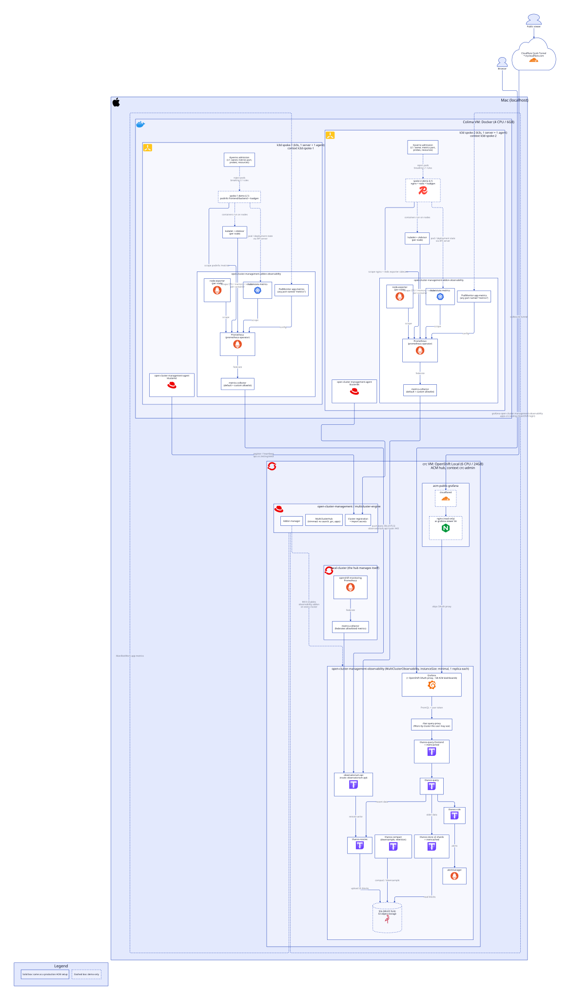
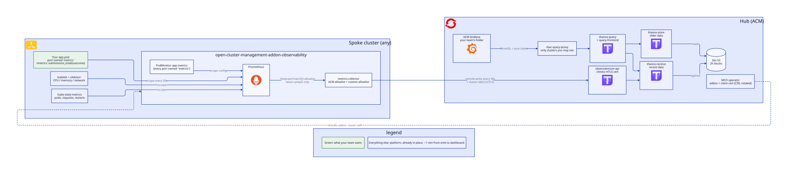
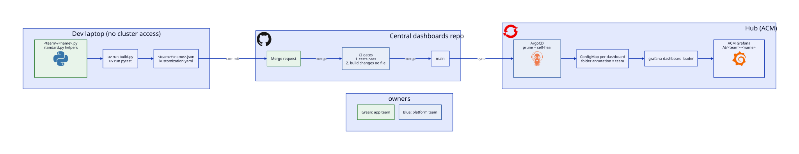

# Architecture

← [Docs](../README.md). d2 sources sit next to their SVGs. Re-render by hand after editing, and commit both:
```bash
cd doc/architecture && d2 --layout elk <name>.d2 <name>.svg
```

## System
The whole POC on one Mac: the crc hub, two k3d spokes, and the observability stack. Used by [setup](../platform/setup.md).



## Metric path
How an app's metric reaches a dashboard. Used by [app teams → metrics](../app-teams/1-metrics.md).



## Dashboard delivery
How a dashboard gets from Python to ACM Grafana. Used by [app teams → ship](../app-teams/3-ship.md).


