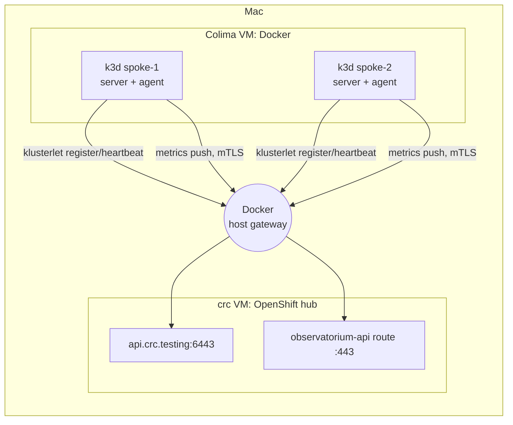

# 0001: k3d (k3s in Docker) for spoke clusters

- **Status:** Accepted, 2026-10-27

## Context
- Goal: a real ACM fleet on one Mac: 1 OpenShift hub plus N managed clusters with their own workloads and metrics.
- crc runs **one** OpenShift cluster per machine. Single Node OpenShift needs 8 vCPUs and 16GB **each**, which doesn't fit.
- Mac: 14 cores, 48GB RAM, ~46GB free disk. crc takes 6 CPUs and 24GB (see [0002](0002-trimmed-acm-sizing.md)).
- Mocks never joined ACM and graphed the hub's own data, so they couldn't test onboarding, the spoke agent, or differences between clusters.

## Decision
- Spokes are k3s clusters created by k3d, as containers in Colima's Docker: 2 spokes × (1 server + 1 agent).
- Imported with ACM's standard flow: a `ManagedCluster` on the hub, then the generated import manifests on the spoke.
- ACM Observability installs its addon on each spoke: Prometheus, kube-state-metrics, node-exporter and metrics-collector.
- traefik, servicelb and metrics-server are off; nothing uses them.
- Colima: 4 CPUs, 6GB, 20GB disk. Code lives in `platform-tools/acm/spoke-clusters/`.

### Connecting to crc
- crc's `*.crc.testing` names resolve to the Mac's `127.0.0.1`; from inside Docker the Mac is the host gateway.
- `k3d-cluster.yaml` `hostAliases` map the hub names to the gateway: API, `observatorium-api`, `alertmanager`, `cluster-proxy-anp`.
- Real names mean the hub's TLS certificates validate, with no `insecure` flags.
- Agent images come from `registry.redhat.io`, so the nodes get crc's pull secret through k3s `registries.yaml`. Behind WARP they also need the Cloudflare CA.

## Why k3d
- Lightest multi-node Kubernetes: a single binary, SQLite instead of etcd, and nodes are containers, not VMs.
- Reuses the Docker that's already installed; no new hypervisor.
- One config file covers nodes, host aliases, registry auth and the CA.
- A spoke is created or deleted in about a minute, so rebuilding is cheap.

## Fidelity vs OpenShift spokes
- k3s doesn't imitate OpenShift. Each spoke is a real **non-OpenShift** cluster, which ACM supports.
- Same as real: import flow, klusterlet, the addon, the allowlist, the mTLS push, Thanos, `rbac-query-proxy`, multi-node scheduling.
- `local-cluster` is the OpenShift example.

| | OpenShift spoke | k3s spoke |
|---|---|---|
| Metric source ([0003](0003-acm-observability-addon.md)) | Platform Prometheus, federated | ACM-installed Prometheus |
| etcd, cluster version, operators | Yes | No (SQLite, not OpenShift) |
| `vendor` label | OpenShift | Other |
| Routes, SCCs, OAuth, OLM | Yes | No |

- etcd on a spoke means 3 servers, about 1GB more.

## Alternatives
| Option | Rejected because |
|---|---|
| Keep mocks | No real data, never join |
| 2nd crc / SNO / OKD | One crc per machine; SNO is 8 vCPU / 16GB each |
| MicroShift | One VM per spoke, single node. Revisit if OpenShift spoke behaviour matters |
| kind | Works, but heavier per node (etcd); host aliases, registry and CA need more setup |
| k3s in multipass/Lima VMs | One VM per node; harder to reach crc's localhost names |
| Cloud spoke | Costs money; crc's API would have to be public |

## Consequences
- RAM: the two VMs reserve 30 of 48GB. Grow one only by shrinking the other.
- Disk: the Mac's free space is the tightest limit; crc's disk can't shrink.
- A 3rd spoke needs a higher `fs.inotify.max_user_instances` in Colima.
- Networking is local only: no LB, firewall, latency or outages.
- Spoke nodes hold crc's pull secret. Production would use a mirror or scoped credentials.
- `hostAliases` changes apply only to new clusters: `./spokes.sh down && ./spokes.sh` (~5 min).
