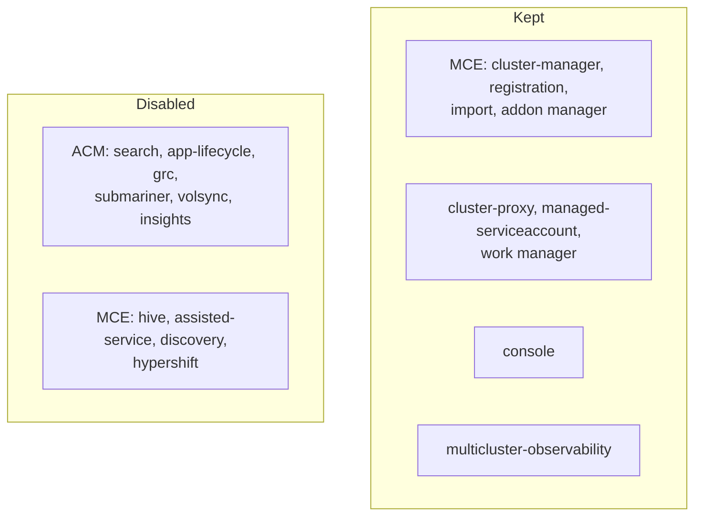

# 0002: Trimmed ACM and Observability to fit crc at 6 CPUs / 24GB

- **Status:** Accepted, 2026-10-27
- **Files:** `platform-tools/acm/install/02-multiclusterhub.yaml`, `04-observability.yaml`, `install.sh`

## Context
- crc runs on the same Mac as the spokes ([0001](0001-k3d-spoke-clusters.md)): 14 cores, 48GB.
- Defaults don't fit on one node:
  - Full ACM: 2 replicas per component, plus search (postgres), governance, app lifecycle, Hive and others.
  - MCO `instanceSize: minimal` still requests ~10 CPU cores (each store shard asks for 2) and runs 2–3 replicas of each component.
  - MCO PVC defaults are up to 100Gi each, against a 100GB crc disk.
- First attempt, 8 CPUs / 32GB: worked, but left too little for the spokes and macOS.

## Decision
- crc: 6 CPUs, 24GB RAM, 100GB disk.
- Keep only what multicluster observability needs.
- Run 1 replica of everything, request only what's actually used, and use small PVCs.

### What was disabled and why
| Component | What it does | Why it's off |
|---|---|---|
| search | Console search across clusters | Its postgres alone requests 1Gi; not used for metrics |
| app-lifecycle | Subscriptions and channels for app delivery | We deploy with `oc apply -k` |
| grc | Governance policies | Not in scope |
| submariner-addon | Cross-cluster pod networking | Metrics go over HTTPS, not pod networking |
| volsync | Volume replication | No stateful DR |
| insights | Red Hat Insights | Not used, and phones home |
| hive, assisted-service, discovery, hypershift | Provision new clusters | We **import** existing clusters only |

Rule: off unless it's on the path import → addon → push → Thanos → Grafana.

### Sizing
- `availabilityConfig: Basic` on MCH and MCE: 1 replica per component.
- MCO `advanced`: `replicas: 1` and requests cut to 20–100m CPU and 64–512Mi each, close to measured use.
- PVCs: 1–5Gi each.
- MCE components are patched one at a time in `install.sh`; a merge patch would replace the whole component list and drop `local-cluster`.

## Result (measured)
- crc uses ~16–18 of 24GB RAM and ~1 core at idle.
- ACM-related namespaces use ~4GB in total; observability is the largest at ~1.5GB.

## Tradeoffs
- No HA: one replica of Thanos receive, query and Grafana; a pod restart is a gap or an outage.
- Requests are below what a busy hub needs. Many more clusters or series → OOM or throttling.
- Small PVCs: short local retention, and the receive buffer fills fast if object storage is down.
- Lost features: no console search, policies, app delivery or cluster provisioning. Re-enable with `enabled: true` in `02-multiclusterhub.yaml` or `oc edit mce multiclusterengine`.
- Not production sizing. Production hub: 3 receive replicas with replication factor 3, ≥2 query and alertmanager, external S3, MCO `instanceSize` matched to the fleet, and the `advanced` block dropped.
