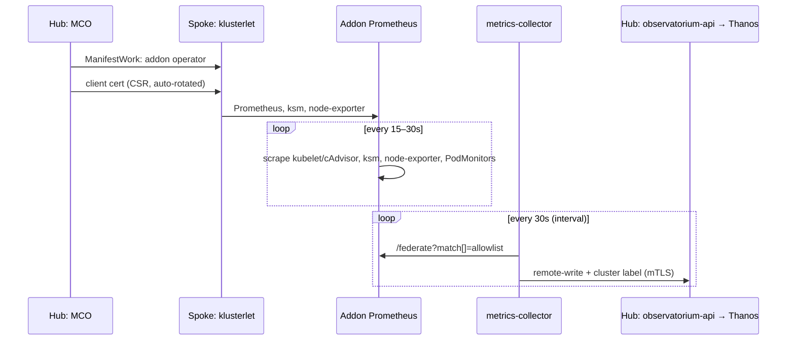
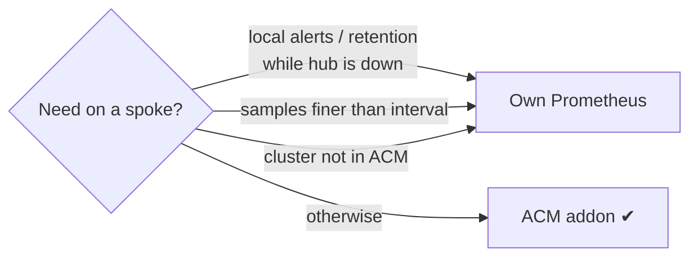

# 0003: Spoke metrics via ACM's observability addon, not a self-managed Prometheus

- **Status:** Accepted, 2026-10-27 (recorded 2026-11-02)
- **Files:** `platform-tools/acm/install/04-observability.yaml`, `platform-tools/grafana/dashboards/metrics-allowlist.yaml`, `spoke-clusters/spoke-*/managed-cluster.yaml`
- **Built on by:** [0004](0004-per-pod-app-metrics.md) (app metrics through the same addon)

## Context
- Every spoke's metrics have to land in the hub's Thanos with a `cluster` label, so `rbac-query-proxy` can filter by cluster and ACM Grafana can query them.
- Enabling `MultiClusterObservability` on the hub installs the addon on **every** managed cluster automatically. A spoke is never left without a Prometheus.

**Criteria, ranked:**
1. **Fidelity:** the supported path every ACM fleet already runs, so what works here holds in production.
2. **No per-spoke ops:** no credentials, Helm releases or values files to maintain for each spoke.
3. **Central cardinality control:** the hub decides which series it stores.
4. **Footprint:** spokes run on 4 CPU / 6GB in total ([0001](0001-k3d-spoke-clusters.md)).

## Decision
- Use ACM's addon (`open-cluster-management-addon-observability`) as the **only** metrics agent on each spoke. No Prometheus Helm chart.
- Tune it from the hub only:
  - `interval: 30s` in `04-observability.yaml`;
  - hub-wide allowlist: `metrics-allowlist.yaml`;
  - per-spoke additions: ManifestWork ([0004](0004-per-pod-app-metrics.md)).

Every hop, through to Grafana: [metric path](../architecture/README.md#metric-path).

### What the addon runs, by spoke type
| | OpenShift (`local-cluster`) | k3s spokes |
|---|---|---|
| Metric source | Platform `openshift-monitoring` Prometheus | Prometheus the addon installs |
| The addon deploys | metrics-collector only | prometheus-operator, Prometheus, kube-state-metrics, node-exporter, metrics-collector |
| Path to the hub | Same: federate, allowlist, mTLS push | Same |

Other differences between spoke types: [0001 fidelity](0001-k3d-spoke-clusters.md#fidelity-vs-openshift-spokes).

## Why not the alternatives
| Option | Rejected because |
|---|---|
| kube-prometheus-stack (Helm) + remote-write to observatorium-api | Skips ACM's collector and allowlist. Needs a copy of the addon's rotating client cert, and a hand-set `cluster` label (a typo hides the cluster behind `rbac-query-proxy`). One Helm release per spoke |
| Own Prometheus (Helm), federated by the addon's Prometheus | Two Prometheus per spoke (+~200MB), one more hop, and the addon's scrape config still needs editing |
| Prometheus Agent mode / OTel Collector, remote-write | Lighter, but it skips the collector and allowlist the same way, so the cert and label problems remain. Not ACM-supported |
| Grafana datasource per spoke Prometheus (no hub storage) | No fleet-wide queries, no `rbac-query-proxy`, a datasource per spoke, and the hub has to reach into every spoke |

## Consequences
- **Hub resolution = `interval`:** federation sends only the latest sample each push. Dashboards need `rate()` windows of at least 2× interval (≥1m).
- **The allowlist decides what's on the hub:** a series can be scraped on the spoke and still be missing on the hub. When a metric is missing, check the allowlist first.
- **One shared Prometheus per spoke:** a noisy target slows scrapes for every team (`sample_limit` in production). No alerting or retention on the spoke itself: if the hub is down, so is alerting.
- **Lifecycle belongs to ACM:** addon upgrades come with ACM. ACM recreates the addon namespace when a cluster re-registers, so our objects go through ManifestWork. `vendor: auto-detect` gotcha: [0004](0004-per-pod-app-metrics.md#consequences).

## Revisit when
- A spoke has to alert while the hub is unreachable.
- Someone needs samples finer than 30s on the hub.
- Clusters outside ACM have to be observed.
