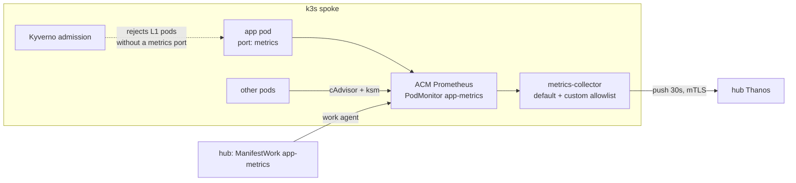

# 0003: Every pod's own metrics reach the hub, enforced with Kyverno

- **Status:** Accepted, 2026-10-27
- **Files:** `platform-tools/acm/spoke-clusters/metrics/manifestwork.yaml`, `kyverno/`, `check-metrics.sh`, `spoke-*/apps.yaml`
- **Onboarding guide:** [app-teams/1-metrics.md](../app-teams/1-metrics.md)

## Context
- ACM's spoke Prometheus only scrapes platform targets: kubelet/cAdvisor, kube-state-metrics, node-exporter, CoreDNS, control plane.
- App pods only had pod-level metrics (CPU, memory, restarts). Their own `/metrics` weren't scraped.
- Why ACM can't do it out of the box:
  - prometheus-operator runs with `--namespaces=open-cluster-management-addon-observability`, so it only sees monitors in that namespace.
  - Prometheus SA `prometheus-k8s` can't list pods outside it.
  - The collector forwards allowlisted series only.
  - ACM's user-workload collector is OpenShift-only in practice: it is gated on `openshift-user-workload-monitoring/prometheus-user-workload` existing, and its recording rules query an OpenShift thanos-querier.

## Decision
- Reuse ACM's spoke Prometheus. One `PodMonitor` in the addon namespace scrapes **every container port named `metrics`, in every namespace**.
- Deliver it from the hub as a `ManifestWork` `app-metrics` in each spoke's namespace, containing:
  - the PodMonitor;
  - a ClusterRole/Binding so `prometheus-k8s` can discover pods everywhere;
  - `observability-metrics-custom-allowlist` matching the PodMonitor's job (forward everything it scrapes);
  - an `aggregate-to-work` ClusterRole so the work agent may manage PodMonitors.
- Kyverno, admission controller only, with ValidatingPolicy `require-metrics-port`: in namespaces labelled `golden-path.level=L1`, every pod needs a `metrics` port, unless annotated `golden-path/metrics-exempt: "<reason>"`.
- Software without native metrics gets an exporter sidecar (nginx: `nginx-prometheus-exporter`; redis: `redis_exporter`).

## Why not the alternatives
| Option | Rejected because |
|---|---|
| Own Prometheus per spoke (like OpenShift UWL) | Getting it to the hub still means editing ACM's side (federate or remote-write with ACM's client cert). +200MB per spoke, more hops |
| Force ACM's UWL collector (dummy `openshift-*` StatefulSet) | It still reads ACM's Prometheus, and failing recording-rule queries break every push |
| Remote-write to observatorium-api | Skips ACM's collector and allowlist; needs a copy of a rotating client cert |
| Apply the objects to the spoke directly | ACM deletes and recreates the addon namespace on re-registration, which wipes them. ManifestWork restores them |
| Annotations (`prometheus.io/scrape`) | Not the prometheus-operator convention; a named port is enough |
| Monitors for ACM's own agents | Vendor pods change with ACM upgrades; pod-level metrics are enough |

## Scope
- In: every pod with a `metrics` port, in any namespace on any spoke (today: demo apps, CoreDNS, the addon operator and collector).
- Pod-level only: pods without a `metrics` port, e.g. ACM agents, local-path-provisioner, Kyverno, loadgen (exempt).
- Out: the hub. No hub apps need it; MCO's `userWorkloads` collection stays off.
- Proven by `check-metrics.sh`: every running spoke pod is on the hub, L1 pods with `up == 1`.

## Consequences
- ~1k extra series per spoke on the hub. A chatty app can blow this up: the allowlist forwards everything the PodMonitor scrapes.
- Both ACM Prometheus and the PodMonitor are shared: a broken target is visible to everyone, and one bad app can slow scrapes for all.
- A `metrics` port on a non-HTTP or TLS endpoint shows `up == 0`. Teams name the port only when it serves plain `/metrics`.
- Kyverno costs ~128Mi per spoke. With background/reports off, there are no policy reports for pods that existed before the policy.
- Gotcha found here: `vendor: auto-detect` on a re-applied `ManagedCluster` makes MCO uninstall the addon. The labels are left to ACM.
- Production: ACM grc policies or GitOps would deliver the ManifestWork content fleet-wide, Kyverno would run HA with reports, and limits per team would come from `sample_limit` on the monitor.
