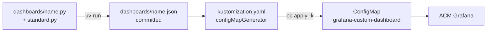

# 0004: Dashboards as code with Grafana Foundation SDK (Python, uv)

- **Status:** Accepted, 2026-10-29
- **Files:** none yet. Next: `dashboards/`, `.claude/skills/grafana-dashboard/`

## Context
- We want one "mega" platform dashboard in ACM Grafana, and then more dashboards that all share one design language: layout, row order, units, colours, thresholds and variables (README, constraint "Consistent design").
- **Author:** a Claude skill writes and edits the dashboards, and humans review the diffs. The platform team goes first; app teams use the same skill later.
- **Target: ACM Grafana only.** Every custom dashboard lives there, so engineers have one place to look, next to ACM's own dashboards and with the same per-cluster RBAC (`rbac-query-proxy`).
  - ACM Grafana 12.4.0 is operator-owned and sits behind the OpenShift OAuth proxy, with no API token. It loads only ConfigMaps labelled `grafana-custom-dashboard: "true"` (README, Grafana section).
  - The separate Grafana Operator instance (`GrafanaDashboard` CRs via argohub) gets no new custom dashboards.
- **Criteria:** (1) maintainability, (2) extensibility, (3) features, DX and ease of use.

### Already settled for the mega dashboard (not decided here)
- One dashboard, one collapsible row per business question.
- Shared variables: `cluster`, `node_group`, `namespace`.
- Node group = regex on the node name: `w-*` worker, `i-*` infra, otherwise control plane via `kube_node_role`.
- Over/under-provisioning = usage ÷ request bands: under 30% is waste, over 100% is bursting, no request set is flagged.
- App teams self-serve by filtering on their namespace, through a pre-filtered link in the golden-path doc.
- Endpoints follow the podinfo convention: `http_request_duration_seconds` and `http_requests_total`, labelled `path`, `method`, `status`.
- Network signals come from node-exporter today; NetObserv comes later as an extra row ([research](../research/network-observability.md)).
- Per-pod CPU, network, phase and restart metrics are added to the custom allowlist.

## Same for every option
- The output is classic dashboard JSON, and the **generated JSON is committed**. Applying needs no toolchain, and reviewers can see the rendered diff.
- A kustomize `configMapGenerator` wraps the JSON into an ACM dashboard ConfigMap. That's the only delivery path.



## Options
The same panel in each option: "CPU usage ÷ request, by namespace".

### A. Raw JSON + golden template + lint
The skill copies `template.json` and edits it. A stdlib `lint.py` checks that every panel has a unit, that the datasource is a variable, and that the standard variables exist.
```json
{"type": "stat", "title": "CPU usage / request", "fieldConfig": {"defaults": {"unit": "percentunit",
  "thresholds": {"mode": "absolute", "steps": [{"color": "orange", "value": null}, {"color": "green", "value": 0.3}, {"color": "red", "value": 1}]}}},
  "targets": [{"datasource": {"uid": "${datasource}"}, "expr": "sum by (namespace) (...) / sum by (namespace) (...)"}]}
```

### B. Stdlib Python dict helpers
`panels.py` holds our own `utilisation()`, `red()` and `row()` functions, which return dicts; then `json.dump`. No dependency, but we write and maintain an untyped builder for Grafana's whole schema.
```python
utilisation("CPU usage / request", expr=CPU_RATIO, bands=PROVISIONING)
```

### C. Grafana Foundation SDK, Python ✅ chosen
Grafana's typed builders, generated from Grafana's own schema, plus a thin `standard.py` of our panels.
```python
def utilisation(title, expr):
    return (stat.Panel().title(title).unit("percentunit")
            .thresholds(PROVISIONING_BANDS)
            .with_target(prometheus.Dataquery().expr(expr).legend_format("{{namespace}}")))
```

### D. Grafonnet (Jsonnet)
Grafana's Jsonnet library, the community standard before the SDK. Today it is generated from the same schema as the SDK, and it's labelled "experimental, not meant for production".
```jsonnet
s.utilisation('CPU usage / request', expr=cpuRatio)
```

### E. Terraform grafana provider ❌
The dashboard is still raw JSON (`config_json`), just wrapped in a provider, so it gives no authoring benefit over A. It also needs a Grafana API endpoint and token, and ACM Grafana exposes neither behind the OAuth proxy.

### Out of scope
- **Perses:** a different dashboard format (CNCF), used by OpenShift's Cluster Observability Operator, not ACM Grafana.
- **Grafana Git Sync / grafanactl:** delivery tools, not authoring. They need API access to Grafana.

## Comparison
| | A. Raw JSON | B. Python dicts | C. Foundation SDK | D. Grafonnet |
|---|---|---|---|---|
| **1. Maintainability** | | | | |
| Diff readability, mega dashboard | ❌ thousands of lines; every panel repeats its config | ✅ one line per panel | ✅ one line per panel | ✅ one line per panel |
| Keeping up with Grafana schema changes | ⚠️ manual, breaks only at import | ❌ we own the whole schema | ✅ generated by Grafana from its schema | ✅ same generator as C |
| Bus factor, who can maintain it | ✅ anyone | ✅ Python | ✅ Python | ❌ Jsonnet is niche |
| Support status | n/a | ours | ⚠️ public preview, used in production by Grafana Labs | ❌ experimental, "not for production" |
| **2. Extensibility** | | | | |
| Add a standard panel type | ⚠️ template block + lint rule | ✅ a function | ✅ a function over typed builders | ✅ a function |
| App teams reuse the standards | ⚠️ copy and paste | ✅ import | ✅ import `standard.py` | ✅ import `.libsonnet` |
| Other resources (alerts, folders) | ⚠️ by hand | ❌ by hand | ✅ builders for alert rules too | ⚠️ dashboards only |
| **3. Features, DX, ease of use** | | | | |
| Toolchain | ✅ none | ✅ python3 | ✅ uv, one pinned package | ❌ `jsonnet` + `jb` |
| Learning curve for app teams | ✅ low | ✅ low | ✅ low, IDE autocompletion | ❌ new language |
| Mistakes caught | ❌ at import, or never | ❌ at import | ✅ types and enums, at build time | ⚠️ at build time, untyped |
| UI round-trip, export → code | ✅ paste | ❌ rewrite by hand | ⚠️ port by hand; the SDK can parse JSON into models | ❌ rewrite by hand |
| LLM skill edits reliably | ❌ big JSON, easy to corrupt, costly in tokens | ✅ small files | ✅ small typed files; the build step validates | ⚠️ less training data |
| Consistency | ⚠️ by lint | ✅ by construction | ✅ by construction | ✅ by construction |

## Decision
- **C: Grafana Foundation SDK in Python, run with uv.**
  - Maintainability: Grafana keeps the builders in step with its own schema, so we maintain only `standard.py`.
  - Extensibility: the design language lives in `standard.py` helpers. A new standard panel is one function, and app teams import the same file.
  - DX: Python is already a repo dependency. Type errors fail `uv run`, not Grafana, and the skill edits small, readable diffs.
- **Runner-up:** B, if we ever can't take a dependency. Rejected for now because we would own Grafana's schema.

### Tooling
- Every generator is a single file with a PEP 723 header, run with `uv run dashboards/<name>.py`. There's no venv or requirements file, and the version is pinned in the script:
  ```python
  # /// script
  # requires-python = ">=3.11"
  # dependencies = ["grafana-foundation-sdk==0.0.21"]
  # ///
  ```
- Version: PyPI only has Grafana-specific builds up to `11.6.0`. The plain `0.0.x` releases follow the SDK's `main`, which "is best suited for Grafana >= 12". We pin `0.0.21` for ACM's Grafana 12.4.
- Smoke-tested with `uv run` on 2026-10-29: dashboard, row, query variable, and stat, table, bar gauge and time series panels all build.
- Add `uv` to README's tools table (`brew install uv`).

## Consequences
- **Generated JSON drift:** someone could edit the `.json` directly. The skill always regenerates from `.py` and then diffs; any difference means a hand edit.
- **UI-built dashboards:** porting them into code is a manual step. The skill does it: export JSON, then rewrite with `standard.py`.
- **Public preview:** the builder API may change between `0.0.x` releases. Pinning protects us; read the changelog before bumping.
- **Grafana upgrades:** after ACM upgrades Grafana, bump the SDK pin and regenerate. Panels that fail to build show what changed.
- **One target:** the skill emits only ACM ConfigMaps. Dashboards that exist today as `GrafanaDashboard` CRs stay where they are until someone ports them to code.

## Sources
- Grafana Foundation SDK (Grafana >= 12 note, public-preview status, Python builders): https://github.com/grafana/grafana-foundation-sdk
- Python install and example: https://github.com/grafana/grafana-foundation-sdk/blob/main/python/README.md
- PyPI versions: https://pypi.org/project/grafana-foundation-sdk/#history
- Grafonnet (generated from the SDK, experimental): https://github.com/grafana/grafonnet
- grafonnet-lib (deprecated): https://github.com/grafana/grafonnet-lib
- PEP 723 inline script metadata, as used by `uv run`: https://peps.python.org/pep-0723/
