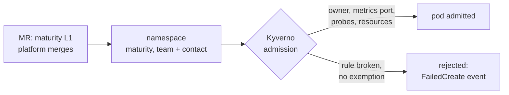

# 0006: Maturity levels L0/L1/L2, enforced per namespace by Kyverno at admission

- **Status:** Accepted, 2026-11-02
- **Builds on:** [0004](0004-per-pod-app-metrics.md): Kyverno already enforced the `metrics` port in L1 namespaces.
- **Files:** `platform-tools/acm/spoke-clusters/kyverno/l1-policies.yaml`, `check-policies.sh`, `spoke-*/apps.yaml`
- **Guide:** [app-teams/0-levels.md](../app-teams/0-levels.md)

## Context
- L1 meant one rule (a `metrics` port). "Production grade" needs more than that: a health signal, predictable scheduling, an owner.
- Teams start as POCs and should be able to move fast, then grow into production without a rewrite.
- Kyverno runs admission-only (reports and background controllers off, [0004](0004-per-pod-app-metrics.md#consequences)). It sees the pods and namespaces on a spoke, but not the dashboards or alerts on the hub.
- Old keys `golden-path.level` and `golden-path/metrics-exempt` mixed `.` and `/` separators, and "golden path" names the docs journey, not the platform.

## Decision
- **Scope: operability.** Can the team see it, run it, and be found? Security and cost are out of scope here.
- **Three levels on the namespace,** label `starlab-platform/maturity: L1`. No label means L0; `L2` is reserved until it's enforced.

  | Level | Name | Enforced |
  |---|---|---|
  | L0 | Explore | nothing |
  | L1 | Operate | owner, `metrics` port, probes, requests + memory limit: Kyverno `Deny` |
  | L2 | Assure | dashboard, SLO + burn-rate alerts, runbooks, `replicas ≥ 2` + PDB: checklist |
- **Verification: admission only.** One `ValidatingPolicy` per rule, on pods (autogen off) and on L1 namespaces. L1 contains only what admission can check; anything on the hub goes to L2.
- **Exemptions:** a per-rule pod annotation `starlab-platform/<rule>-exempt: "<reason>"`, only for metrics and probes. Resources and owner have none.
- **Promotion:** the platform team merges the MR that adds the label. No policy guards the label itself.
- **New rules:** ship as `Warn`, then switch to `Deny` on an announced date.
- **Keys:** `starlab-platform/` prefix for every label and annotation. The contact is an annotation, because label values can't hold `#` or `@`.

## Why not the alternatives
| Option | Rejected because |
|---|---|
| Level per workload, not per namespace | Harder to audit, and easier to dodge; one namespace per app is already the norm |
| Continuous audit (Kyverno reports, CI checks against the hub) | Brings back the reports controller (~memory per spoke) and a hub-side checker; admission covers L1 |
| Kyverno `Audit` at L0 as a readiness preview | Same cost; `oc apply --dry-run=server` gives the same preview on demand |
| Enforce L2 now | Needs SLO tooling (e.g. Sloth, Pyrra) and hub-side checks this repo doesn't have |
| Owner labels at L0 too | Every new namespace would need them, and platform namespaces an exclusion list; L0 stays frictionless |
| Teams set the label themselves | Production is a platform commitment too (on-call, capacity); the MR is where both sides agree |
| Names as label values (`operate`) | No order, and renaming later means relabelling; the docs carry the names |
| One generic `exempt` annotation listing rules | Parsing a list in CEL is fragile; per-rule keys are easy to grep |

## Consequences
- An L1 Deployment that breaks a rule still rolls out, but gets no pods. Teams look for `FailedCreate` events, not `oc apply` errors.
- Pods created before a rule existed aren't re-checked until they're recreated (no background scans).
- L2 is a promise, not a guarantee: nothing stops an L2 namespace's dashboard or alerts from rotting. The namespace label stays `L1` until L2 is enforced.
- Changing a rule means changing `l1-policies.yaml`, `check-policies.sh` and the table in `0-levels.md` together.
- Production: deliver the policies fleet-wide with ACM governance or GitOps, run Kyverno HA with reports on, and add a hub-side check for L2 (every L2 namespace has a dashboard and burn-rate alerts).
