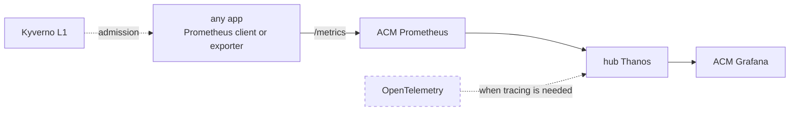

# 0007: Metrics only, on Prometheus and Grafana; OpenTelemetry deferred until tracing is needed

- **Status:** Accepted, 2026-11-03
- **Builds on:** [0004](0004-per-pod-app-metrics.md) metrics pipeline · [0005](0005-dashboards-as-code.md) dashboards as code · [0006](0006-maturity-levels.md) L1 enforcement
- **Guide:** [app-teams/1-metrics.md](../app-teams/1-metrics.md)

## Context
- OTEL is able to provide an interface for emitting metrics, traces, logs. We considered that metrics should be handled by Prometheus which comes out of the box with openshift ACM prometheus.
- There is no real need for traces and logs. If they are needed, then the team should design the OTEL pipeline separately. That pipeline will be another "lego block" platform offering that teams can opt in to. Metrics will still use the existing Redshift Prometheus setup.
- Trace and logs adds additional complexity and overhead for no real reason now. We should assess if we are designing that solution way too early before a real need surfaces.

## Decision
- **Metrics only, in the Prometheus format.** Every app serves `/metrics` on a container port named `metrics`, through any Prometheus client library or exporter. Traces and logs are out of scope.
- **The platform enforces only what it can see.** Kyverno checks the L1 rules at admission ([0006](0006-maturity-levels.md)), naming ([1-metrics.md](../app-teams/1-metrics.md)) is checked in review, and the language and library are the team's choice.
- **Revisit when a team needs distributed tracing.** Design the OpenTelemetry pipeline in a new ADR: collector, trace backend, and how it fits with Prometheus metrics.

## Consequences
- **Traces and logs can be added later without touching metrics.** An OpenTelemetry pipeline would be an opt-in offering; apps, dashboards and L1 rules stay on ACM Prometheus.
- **Metric quality is the team's job.** Kyverno checks that the `metrics` port exists, not what it serves, so naming drift shows up in review or as an empty dashboard.
- **No request-level view across services** until tracing is added; debugging relies on metrics and pod logs.
