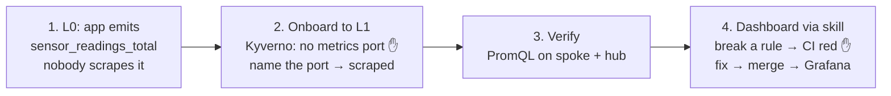

# Demo: a team matures to L1 and gets its own dashboard

← [Docs](../README.md) · guides used: [0. Levels](../app-teams/0-levels.md) · [1. Metrics](../app-teams/1-metrics.md) · [2. Dashboard](../app-teams/2-dashboards.md) · [3. Ship](../app-teams/3-ship.md)

**Story:** `sensor-team-2` runs `worker-1` at L0. They've already added code that emits a success metric, and now they want it on a Grafana dashboard. They move to L1, and Kyverno blocks the deploy for exactly one reason: no port named `metrics`. Fixing that is what gets the metric scraped, and then they ship a dashboard through a gated PR.



| | Where | About |
|---|---|---|
| App | `sensor-team-2-monorepo/worker-1/main.go` | a sensor read every 5 s: `sensor_readings_total{outcome}` (~10% fail), `sensor_reading_celsius` |
| Manifests | `sensor-team-2-monorepo/deploy/` | `namespace.yaml`, `deployment.yaml`, `kustomization.yaml` |
| Cluster | spoke-2 (`k3d-spoke-2`) | hub is crc, Grafana: https://grafana-open-cluster-management-observability.apps-crc.testing |

> **Why L0 isn't scraped.** ACM's Prometheus scrapes only container ports **named `metrics`** ([ADR 0004](../decisions/0004-per-pod-app-metrics.md)). The L0 deployment is otherwise production-ready (probes, resources) but serves `/metrics` on a port named `http`, so the metric exists and nobody collects it. L1's `require-metrics-port` rule is the only thing it fails, and its fix is exactly what gets the team scraped.

---

## 0. Before the demo (~10 min, not live)

### One-off: make CI a merge gate (GitHub)
`.github/workflows/dashboards.yaml` runs on every PR. To make it block merges:
1. **Settings → Branches → Add branch ruleset** (or classic rule) for `main`.
2. Tick **Require a pull request before merging**.
3. Tick **Require status checks to pass**, and add `gate`. It only shows in the list after the workflow has run once.

### Pre-flight
```sh
eval "$(crc oc-env)"                                   # oc on PATH
s2() { oc --context k3d-spoke-2 "$@"; }                # spoke-2 shortcut (a function, not a "$VAR": zsh won't split it)
crc status | grep OpenShift                            # Running
colima status && k3d cluster list                      # both spokes 1/1
./platform-tools/acm/spoke-clusters/check-metrics.sh   # OK: every running spoke pod has metrics on the hub
(cd platform-tools/grafana/dashboards && uv run pytest -q)   # all green, warms the uv cache
```
- Log in to Grafana in the browser now, so the OAuth page doesn't interrupt the demo.
- Image present? `cd sensor-team-2-monorepo && make docker && k3d image import worker-1:dev -c spoke-2`

### Scripts: one per step, each puts files and cluster in that step's start state
Re-runnable in any order, so you can retry or skip a step live. Shared manifests and helpers: `demo/lib.sh`.

| Script | Puts you at | `deploy/namespace.yaml` | `deploy/deployment.yaml` | Cluster |
|---|---|---|---|---|
| `demo/step1.sh` | **1.** not onboarded | L0, no labels | port `http` | worker-1 running, not scraped; no sensor-team-2 dashboard |
| `demo/step2.sh` | **2.** onboarding, blocked | L1 + owner | port `http` | old pod running, new pod denied by `require-metrics-port` |
| `demo/step3.sh` | **3.** fixed, scraped | L1 + owner | port `metrics` | new pod running, `up == 1` on spoke-2 |
| none | **4.** dashboard | | | generated live with the skill |

- Probes and resources are in every state, so `require-metrics-port` is the only L1 rule the team can fail.
- `step1.sh` also deletes `dashboards/sensor-team-2/` and its ConfigMap on the hub. Run it about 5 min before going live, so old series age out.

---

## 1. The team's app emits a metric, but nobody collects it (~3 min)
`demo/step1.sh` (before the demo).

**Say:** "sensor-team-2 already changed their code: every reading is counted by outcome. Is it on the hub?"

1. **Show the code:** `worker-1/main.go`, the `sensor_readings_total` counter with an `outcome` label (the [1-metrics](../app-teams/1-metrics.md) pattern).
2. **The app emits it:**
   ```sh
   s2 -n sensor-team-2 port-forward deploy/worker-1 8080 &
   curl -s localhost:8080/metrics | grep '^sensor_'; kill %1
   ```
   Expect `sensor_readings_total{outcome="success"} N`.
3. **The hub doesn't have it:** in Grafana → **Explore**, run:
   ```promql
   up{namespace="sensor-team-2"}
   ```
   Expect **No data**: the pod isn't scraped.

**Point:** emitting isn't enough; the platform only collects from a port named `metrics`.

## 2. Onboard to L1: Kyverno blocks on the missing metrics port (~6 min)
**Say:** "To be operated like production, the team moves to L1. L1 is enforced at admission, and one of its rules is: *we must be able to see you*."

Live: make the edits below. Or `demo/step2.sh` makes them and reaches 2b in one go.

### 2a. Label the namespace L1
Edit `deploy/namespace.yaml`:
```yaml
metadata:
  name: sensor-team-2
  labels: {starlab-platform/maturity: L1, starlab-platform/team: sensor-team-2}
  annotations: {starlab-platform/contact: "#sensor-team-2-oncall"}
```
```sh
s2 apply -k deploy/                                  # namespace configured, deployment unchanged
s2 -n sensor-team-2 rollout restart deploy/worker-1  # a new pod must now pass L1
```

### 2b. Kyverno blocks: no port named `metrics`
```sh
s2 -n sensor-team-2 get events --field-selector reason=FailedCreate -o custom-columns=WHY:.message --no-headers | tail -1
s2 -n sensor-team-2 get pods                         # the old pod keeps running: no outage
```
Expect:
```
admission webhook ... denied the request: Policy require-metrics-port failed: starlab-platform L1:
expose a container port named "metrics", or annotate the pod with starlab-platform/metrics-exempt: "<reason>".
See doc/app-teams/1-metrics.md.
```
- **Point:** the error links the team straight to [1-metrics](../app-teams/1-metrics.md), the guide for getting their metric to Grafana. The policy isn't red tape; it's the onboarding instruction.
- **Point:** policies check pods, not Deployments. The apply succeeded, the new pod is rejected, and the running pod stays up.

### 2c. Name the port → deploy succeeds, and the metric is scraped
Edit the container in `deploy/deployment.yaml` (the `http` → `metrics` rename):
```diff
-          ports: [{name: http, containerPort: 8080}]   # serves /metrics, but not on a port named "metrics"
-          readinessProbe: {httpGet: {path: /metrics, port: http}}
-          livenessProbe: {httpGet: {path: /metrics, port: http}}
+          ports: [{name: metrics, containerPort: 8080}]   # ACM's Prometheus scrapes this port
+          readinessProbe: {httpGet: {path: /metrics, port: metrics}}
+          livenessProbe: {httpGet: {path: /metrics, port: metrics}}
```
```sh
s2 apply -k deploy/ && s2 -n sensor-team-2 rollout status deploy/worker-1
```
- Skip the live edit: `demo/step3.sh`.

**Point:** one rename satisfied L1 *and* turned on collection: the same port name is the admission rule and the scrape target.

## 3. Verify the metric arrives (~3 min, the hub needs ~1 min)
**Spoke Prometheus**, immediate:
```sh
s2 -n open-cluster-management-addon-observability exec prometheus-k8s-0 -c prometheus -- \
  promtool query instant http://localhost:9090 'up{namespace="sensor-team-2"}'     # => 1
```
**Hub**, in Grafana → Explore. The cluster label is added on the hub:

| Query | Expect |
|---|---|
| `up{cluster="spoke-2", namespace="sensor-team-2"}` | `1`: scraped |
| `sum by (outcome) (increase(sensor_readings_total{cluster="spoke-2", namespace="sensor-team-2"}[1m]))` | success ≈ 11, failure ≈ 1 (one read per 5 s) |
| `sensor_reading_celsius{cluster="spoke-2", namespace="sensor-team-2"}` | jumps between 15 and 30 (graph view) |
| `sum(rate(sensor_readings_total{cluster="spoke-2", namespace="sensor-team-2", outcome="success"}[5m])) / sum(rate(sensor_readings_total{cluster="spoke-2", namespace="sensor-team-2"}[5m]))` | ≈ 0.9 success rate |

- **Optional:** `./platform-tools/acm/spoke-clusters/check-metrics.sh` proves every L1 pod on every spoke is scraped.

## 4. Dashboard via the skill, gated by CI (~10 min)
### 4a. Generate it
```sh
git switch -c sensor-team-2/dashboard
```
In Claude Code, ask:
> /grafana-dashboard Build a dashboard for sensor-team-2's worker-1 in namespace sensor-team-2: are our sensor reads succeeding? Metrics: `sensor_readings_total{outcome}` (a read every 5s) and `sensor_reading_celsius`.

- **Expect:** `platform-tools/grafana/dashboards/sensor-team-2/worker_1.py`, plus the generated `.json` and `kustomization.yaml`, with `uv run pytest` green. Future URL: `/d/sensor-team-2-worker-1`.
- **Show:** the `.py` is composed from `components/` (`vitals` → `golden_signals` → `extension`), not hand-written JSON.

### 4b. Break a standard → red locally
Pick one break and make it in `worker_1.py`:

| Break | Expected failure |
|---|---|
| A graph's `[{RATE}]` → `[5m]` | `<panel>: windows must be $__rate_interval (widen on zoom), got ['5m']` |
| A panel's description → `""` | `<panel>: say what question the panel answers and what to do when it's red` |
| Drop `per_pod(...)` around a query | `<panel>: slice on the filters with per_pod()/per_node() ...` |
| Hand-edit `worker_1.json` | gate 2: `Run 'uv run build.py' locally and commit the result` |
```sh
cd platform-tools/grafana/dashboards
uv run pytest -q tests/test_conformance.py     # FAILED test_team_dashboard_conforms[sensor-team-2/worker_1.py]
```

### 4c. Push it anyway → CI blocks the merge
```sh
uv run build.py && git add -A . && git commit -m "sensor-team-2: worker-1 dashboard" && git push -u origin HEAD
```
- Open the PR on GitHub. **dashboards / gate** goes red with the same message, and **Merge** is blocked.

### 4d. Fix → green → merge → live
Undo the break in `worker_1.py`, then:
```sh
uv run pytest -q && uv run build.py && git commit -am "fix: follow the golden path" && git push
```
- `gate` goes green. Merge.
- **Delivery** ([ADR 0005](../decisions/0005-dashboards-as-code.md), [dashboard delivery](../architecture/README.md#dashboard-delivery)):
  1. `build.py` wrote `worker_1.json` and a `configMapGenerator` entry in `kustomization.yaml`.
  2. ArgoCD syncs `main` to the hub. There's no ArgoCD locally, so run `oc apply -k platform-tools/grafana/dashboards`.
  3. That creates ConfigMap `grafana-dashboard-sensor-team-2-worker-1` in `open-cluster-management-observability`, labelled `grafana-custom-dashboard: "true"` and annotated with the folder.
  4. ACM's `grafana-dashboard-loader` sidecar sees the label and posts the JSON to Grafana (~1 min).
- **Open:** Grafana → Dashboards → `sensor-team-2` → the dashboard, or `/d/sensor-team-2-worker-1`. It opens on `namespace=sensor-team-2`.

**Point:** the team never touched the cluster or the Grafana UI. The standard is code, CI enforces it, and GitOps ships it.

---

## If something goes wrong
| Symptom | Check / fix |
|---|---|
| Explore: No data on the hub after 2 min | `s2 -n open-cluster-management-addon-observability logs deploy/metrics-collector-deployment --tail=3`; `no such host` → re-run `./platform-tools/acm/spoke-clusters/spokes.sh` (hub DNS) |
| `up` = 0 | the `metrics` port isn't serving plain `/metrics` |
| 2b shows no event | the restart didn't create a pod yet: rerun the `get events` after ~2 s |
| 2b denied by another policy | the reset's deployment lost its probes or resources: re-run the reset |
| `ErrImageNeverPull` | `make docker && k3d image import worker-1:dev -c spoke-2` |
| `fsnotify: too many open files` | `colima ssh -- sysctl fs.inotify.max_user_instances`, should be 1024 |
| `gate` not selectable as a required check | it appears only after the workflow ran once: open any PR first |
