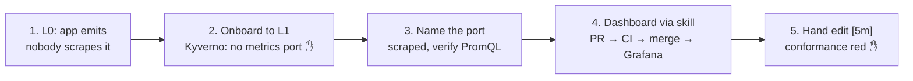

# Demo: a team matures to L1 and gets its own dashboard

← [Docs](../README.md) · guides used: [0. Levels](../app-teams/0-levels.md) · [1. Metrics](../app-teams/1-metrics.md) · [2. Dashboard](../app-teams/2-dashboards.md) · [3. Ship](../app-teams/3-ship.md)

**Story:** `sensor-team-2` runs `worker-1` at L0. It already emits RED and business metrics, and the team wants them on a Grafana dashboard. They move to L1, and Kyverno blocks the deploy for one reason: no port named `metrics`. Fixing that gets them scraped. Then they generate a dashboard with the skill, and CI blocks a hand edit that breaks the golden path.



| | Where | About |
|---|---|---|
| App | `sensor-team-2-monorepo/worker-1/main.go` | a sensor read every 5 s: `sensor_readings_total{outcome}` (~10% fail), `sensor_reading_celsius`; `/read` endpoint with RED histogram `http_request_duration_seconds{path,method,status}` |
| Mock traffic | `sensor-team-2-monorepo/deploy/loadgen.yaml` | busybox calling `/read` ~5×/s (~10% 503), present at every step |
| Manifests | `sensor-team-2-monorepo/deploy/` | `namespace.yaml`, `deployment.yaml` (written by the step scripts), `loadgen.yaml`, `kustomization.yaml` |
| Cluster | spoke-2 (`k3d-spoke-2`) | hub is crc, Grafana: https://grafana-open-cluster-management-observability.apps-crc.testing |

> **Why L0 isn't scraped.** ACM's Prometheus scrapes only container ports **named `metrics`** ([ADR 0004](../decisions/0004-per-pod-app-metrics.md)). The L0 deployment is otherwise production-ready (probes, resources) but serves `/metrics` on a port named `http`. L1's `require-metrics-port` is the only rule it fails, and its fix is exactly what gets the team scraped.

---

## 0. Before the demo (~10 min, not live)

### One-off: make CI a merge gate (GitHub)
`.github/workflows/dashboards.yaml` runs on every PR. To make it block merges:
1. **Settings → Branches → Add branch ruleset** (or classic rule) for `main`.
2. Tick **Require a pull request before merging**.
3. Tick **Require status checks to pass**, and add `gate`. It only shows in the list after the workflow has run once.

### Pre-flight
```sh
eval "$(crc oc-env)"                                   # oc on PATH
s2() { oc --context k3d-spoke-2 "$@"; }                # spoke-2 shortcut (a function, not a "$VAR": zsh won't split it)
crc status | grep OpenShift                            # Running
colima status && k3d cluster list                      # both spokes 1/1
./platform-tools/acm/spoke-clusters/check-metrics.sh   # OK: every running spoke pod has metrics on the hub
(cd platform-tools/grafana/dashboards && uv run pytest -q)   # all green, warms the uv cache
demo/step1.sh                                          # ~5 min before going live: the hub keeps old series for ~5 min
```
- Log in to Grafana in the browser now, so the OAuth page doesn't interrupt the demo.

### Step scripts: each one declares its state
Every script converges files **and** cluster to its step's state from **any** state. Run any step, in any order, as often as you like. Helpers (`converge`, `dashboard`): `demo/lib.sh`.

| Run | State | Namespace | worker-1 | loadgen | Dashboard |
|---|---|---|---|---|---|
| `demo/step1.sh` | **1.** emits, not scraped | L0, no labels | port `http`, running | running | absent |
| `demo/step2.sh` | **2.** onboarding, blocked | L1 + owner | port `http`: old pod running, replacement denied | running | absent |
| `demo/step3.sh` | **3.** fixed, scraped | L1 + owner | port `metrics`, `up == 1` | running | absent |
| Claude Code `/grafana-dashboard` | **4.** dashboard | as 3 | as 3 | running | generated live |
| `demo/step5.sh` / `undo` | **5.** hand edit, red / green | as 3 | as 3 | running | `demo/fixtures/worker_1.py`, first window `[5m]` / restored |

- **Nothing is deleted on the cluster:** the namespace and pods stay; only manifests and labels change.
- **Probes and resources are in every state**, so `require-metrics-port` is the only L1 rule the team can fail.
- **Dashboard:** steps 1–3 remove `dashboards/sensor-team-2/` and its hub ConfigMap so step 4 starts clean. Commit step 4's output on its branch before re-running them.

---

## 1. The app emits, but nobody collects it (~3 min)
```sh
demo/step1.sh
```
**Say:** "sensor-team-2 already instrumented their code. Is it on the hub?"

1. **Show the code:** `worker-1/main.go`: `sensor_readings_total{outcome}`, `sensor_reading_celsius`, and `instrument()` recording `http_request_duration_seconds` (the [1-metrics](../app-teams/1-metrics.md) pattern).
2. **The app emits it:**
   ```sh
   s2 -n sensor-team-2 port-forward deploy/worker-1 8080 &
   curl -s localhost:8080/metrics | grep -E '^(sensor_|http_request_duration_seconds_count)'; kill %1
   ```
   Expect `sensor_readings_total{outcome="success"} N` and `http_request_duration_seconds_count{...,path="/read",status="200"} N`.
3. **The hub doesn't have it:** Grafana → **Explore** → `up{namespace="sensor-team-2"}` → **No data**.

**Point:** emitting isn't enough; the platform only collects from a port named `metrics`.

## 2. Onboard to L1: Kyverno blocks on the missing metrics port (~5 min)
```sh
demo/step2.sh   # labels the namespace L1, restarts worker-1, prints Kyverno's denial
```
**Say:** "To be operated like production, the team moves to L1. L1 is enforced at admission, and one rule is: *we must be able to see you*."

1. **Show the edit:** `deploy/namespace.yaml` now has `starlab-platform/maturity: L1`, the team label and the contact annotation.
2. **Show the denial** (the script prints it):
   ```
   Policy require-metrics-port failed: starlab-platform L1: expose a container port named "metrics",
   or annotate the pod with starlab-platform/metrics-exempt: "<reason>". See doc/app-teams/1-metrics.md.
   ```
3. **Show the pods:** the old worker-1 pod keeps running; loadgen runs too (it's `metrics-exempt` and `probes-exempt`).

- **Point:** the error links straight to [1-metrics](../app-teams/1-metrics.md). The policy is the onboarding instruction, not red tape.
- **Point:** policies check pods, not Deployments. The apply succeeds, the new pod is rejected, the running pod stays up: no outage.

## 3. Name the port → scraped (~4 min, the hub needs ~1 min)
```sh
demo/step3.sh   # port http -> metrics, applies, waits for spoke-2 Prometheus to scrape
```
1. **Show the fix:** `git diff sensor-team-2-monorepo/deploy/deployment.yaml`: `http` → `metrics` in 3 places.
2. **Spoke:** the script prints `up{namespace="sensor-team-2"} => 1`.
3. **Hub**, Grafana → Explore (the hub adds the `cluster` label):

| Query | Expect |
|---|---|
| `up{cluster="spoke-2", namespace="sensor-team-2"}` | `1` |
| `sum by (outcome) (increase(sensor_readings_total{cluster="spoke-2", namespace="sensor-team-2"}[1m]))` | success and failure, ~9:1 |
| `sensor_reading_celsius{cluster="spoke-2", namespace="sensor-team-2"}` | 15–30 (graph view) |
| `sum by (status) (rate(http_request_duration_seconds_count{cluster="spoke-2", namespace="sensor-team-2"}[1m]))` | `200` ~4.5/s, `503` ~0.5/s (loadgen) |

**Point:** one rename satisfied L1 *and* turned on collection: the port name is both the admission rule and the scrape target.

## 4. Dashboard via the skill, gated by CI (~10 min)
No script: this is the live part.
```sh
git switch -c sensor-team-2/dashboard
```
1. **Generate.** In Claude Code:
   > /grafana-dashboard Build a dashboard for sensor-team-2's worker-1 in namespace sensor-team-2: are our sensor reads succeeding? Metrics: `sensor_readings_total{outcome}` (a read every 5s) and `sensor_reading_celsius`.

   Expect `platform-tools/grafana/dashboards/sensor-team-2/worker_1.py` + `.json` + `kustomization.yaml`, `uv run pytest` green.
2. **Show the `.py`:** composed from `components/`, no hand-written JSON.

   | Row | Holds |
   |---|---|
   | System Vitals | standard: Requests/s, 5xx rate, p95 latency, Peak memory / limit |
   | Golden Signals | standard first per quadrant: p95, Requests/s, 5xx ratio, Memory / limit (by workload) |
   | Extensions | the team's metrics: read success, readings by outcome, temperature |

   - **Point:** the top half is identical on every team's page and comes from `vitals()` / `golden_signals()`. Team metrics can only go in extensions; conformance fails them anywhere else.
3. **Ship:**
   ```sh
   cd platform-tools/grafana/dashboards
   uv run pytest -q && uv run build.py && git add -A . && git commit -m "sensor-team-2: worker-1 dashboard" && git push -u origin HEAD
   ```
   Open the PR: **dashboards / gate** goes green. Merge.
4. **Delivery** ([ADR 0005](../decisions/0005-dashboards-as-code.md), [dashboard delivery](../architecture/README.md#dashboard-delivery)):
   1. ArgoCD syncs `main` to the hub. No ArgoCD locally: `oc apply -k platform-tools/grafana/dashboards`.
   2. ConfigMap `grafana-dashboard-sensor-team-2-worker-1` lands in `open-cluster-management-observability`, labelled `grafana-custom-dashboard: "true"`.
   3. ACM's `grafana-dashboard-loader` posts it to Grafana (~1 min).
5. **Open:** `/d/sensor-team-2-worker-1`, in folder `sensor-team-2`. It opens on `namespace=sensor-team-2`; RED panels show loadgen's traffic.

**Point:** the team never touched the cluster or the Grafana UI. The standard is code, CI enforces it, GitOps ships it.

## 5. A hand edit breaks the golden path → CI blocks it (~3 min)
```sh
demo/step5.sh        # converges to 3 + the dashboard, hard-codes the first [{RATE}] window to [5m], runs the tests
```
1. **Show the edit:** the script prints the `[5m]` line in `worker_1.py`.
2. **Show the failure:** `<panel>: windows must be $__rate_interval (widen on zoom), got ['5m', ...]` (with the fixture: `Read success rate`).
3. **Optional, push it:** `git commit -am "hand edit" && git push` → **dashboards / gate** red with the same message, Merge blocked.
4. **Fix:** `demo/step5.sh undo` → `[{RATE}]` back, tests green.

- **Why it's a rule:** a fixed `[5m]` doesn't widen when you zoom out, so the graph samples too little and hides spikes.
- **Point:** every rule is checked on every PR; a dashboard that drifts from the golden path can't merge.

---

## If something goes wrong
| Symptom | Check / fix |
|---|---|
| Any step left half-done | re-run that step's script: it converges from any state |
| Explore: No data on the hub after 2 min | `s2 -n open-cluster-management-addon-observability logs deploy/metrics-collector-deployment --tail=3`; `no such host` → re-run `./platform-tools/acm/spoke-clusters/spokes.sh` (hub DNS) |
| `up` = 0 | the `metrics` port isn't serving plain `/metrics` |
| Step 2 shows no denial | the restart didn't create a pod yet: `s2 -n sensor-team-2 get events --field-selector reason=FailedCreate` after ~2 s |
| Step 1 denied by `require-owner` | an older `step1.sh`: the current one drops the L1 labels one at a time |
| RED panels empty | `s2 -n sensor-team-2 logs deploy/loadgen`: `bad address` → the `worker-1` Service is missing; re-run the step |
| `ErrImageNeverPull` | `cd sensor-team-2-monorepo && make docker && k3d image import worker-1:dev -c spoke-2` (scripts do this when the image is missing) |
| `fsnotify: too many open files` | `colima ssh -- sysctl fs.inotify.max_user_instances`, should be 1024 |
| `gate` not selectable as a required check | it appears only after the workflow ran once: open any PR first |
