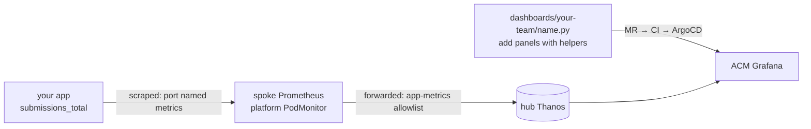

# Golden path: custom business metrics on your dashboard

Service offering for app teams: emit a metric about **your** business outcome (submissions, payments, jobs, …), and see it in your team's ACM Grafana dashboard next to the platform's golden signals. No platform ticket needed.

Prerequisite: your app is onboarded to [app metrics](metrics.md), i.e. it serves `/metrics` on a port named `metrics`.

## Flow


| Step | Who | What |
|---|---|---|
| 1 | Your team | Instrument the app (below) and deploy it to your spoke as usual |
| 2 | Nobody | It's scraped and forwarded automatically, and reaches the hub within about a minute |
| 3 | Your team | Add panels to your dashboard with the `grafana-dashboard` skill, then open an MR ([how dashboards ship](../../platform-tools/grafana/dashboards/README.md)) |

## 1. Instrument: choose the metric type
| You want to know | Emit | Example |
|---|---|---|
| How many things happened, and how many failed | **Counter** with an outcome label | `submissions_total{outcome="success"}` |
| How long they took | **Histogram** in seconds | `submission_duration_seconds_bucket` |
| How many are in flight or queued right now | **Gauge** | `submissions_in_progress` |

Example, success and failure of a submission app:
```
# HELP submissions_total Submissions processed, by outcome.
# TYPE submissions_total counter
submissions_total{outcome="success"} 1042
submissions_total{outcome="failure",reason="validation"} 17
submissions_total{outcome="failure",reason="timeout"} 3
```
Python (`prometheus_client`); every Prometheus client library has the same three types:
```python
from prometheus_client import Counter, Histogram, start_http_server

SUBMISSIONS = Counter("submissions_total", "Submissions processed, by outcome.", ["outcome", "reason"])
DURATION = Histogram("submission_duration_seconds", "Time to process a submission.")

start_http_server(9898)   # the container port named "metrics"

@DURATION.time()
def submit(form):
    try:
        process(form)
        SUBMISSIONS.labels("success", "").inc()
    except ValidationError:
        SUBMISSIONS.labels("failure", "validation").inc()
        raise
```

### Rules
- **Counters, not gauges, for "how many".** A counter survives restarts and scrape gaps (`rate()` handles resets). A gauge of "submissions so far" breaks on every restart.
- **One metric with an `outcome` label,** not `submissions_success_total` and `submissions_failure_total`. The success rate is then one ratio, and new outcomes need no dashboard change.
- **Bounded labels only.** `outcome` and a `reason` from a fixed list are fine. Never use user IDs, submission IDs, emails, raw URLs or error messages: each value is a new series on the hub, and the hub keeps them all.
- **Units in the name, base units in the value:** `_seconds`, `_bytes`, and `_total` for counters.
- **Pre-create the labels you expect** (`SUBMISSIONS.labels("failure", "timeout")`), so a failure series exists at 0 before the first failure. Otherwise "failures" shows "No data" instead of 0.

### Check it's on the hub
Grafana → Explore:
```promql
sum by (cluster, namespace, outcome) (rate(submissions_total[5m]))
```
Nothing there? Run the checks in [metrics.md](metrics.md#see-it): is the port named `metrics`, and does `up` show `1`?

## 2. Add it to your dashboard
Ask the skill: *"/grafana-dashboard add submission success to sensor-team-1/system_a: success rate, submissions by outcome, failures by reason."* Or write it yourself with the same helpers every panel uses, so your metric gets the standard filters, time windows and layout:

```python
OK  = per_pod(f'rate(submissions_total{{{C}, {APP}, outcome="success"}}[{RATE}])')
ALL = per_pod(f'rate(submissions_total{{{C}, {APP}}}[{RATE}])')
BAD = lambda w=RATE: per_pod(f'increase(submissions_total{{{C}, {APP}, outcome="failure"}}[{w}])')

vitals(
    tile("Submission success", "Share of submissions that succeed. Low: see 'Why do submissions fail?'.",
         ratio(f"sum({OK})", f"sum({ALL})"), PERCENT, SUCCESS),
    ...
),
extension("Why do submissions fail?",
    graph("Submissions by outcome", "Submissions per second, by outcome.", REQPS,
          (f"sum by (cluster, outcome) ({ALL})", "{{cluster}} {{outcome}}")),
    grid("Failures by reason", "Failed submissions in the selected range, by reason.",
         ("Failures", f"sum by (cluster, workload, reason) ({BAD(RANGE)})", COUNT, PROBLEMS),
         sort="Failures")),
```

Where it goes:
| The metric answers | Put it in |
|---|---|
| "Is my service OK right now?" (success rate, backlog) | a **Vitals** tile |
| Requests your users make | **Golden Signals**: count in Traffic, failures in Errors, duration in Latency |
| A business question ("Why do submissions fail?") | an **Extension** row titled with that question |

`per_pod(...)` makes your metric follow the cluster, node, namespace, workload and pod filters. The `{APP}` selector limits it to golden-path app metrics.

## What needs the platform team
- **Nothing,** for a new metric from an onboarded app.
- **A "higher is better" colour set** for success rates (`SUCCESS` above): not in the standard yet. Until it is, use `NEUTRAL`, or ask the platform team to add it. It's a small, test-first change to `standard.py`.
- **High cardinality:** if your metric needs more than a few hundred series, talk to the platform team first. Every series is stored on the hub.
- **Metrics from software you don't own** (databases, queues): use an exporter sidecar, as in [metrics.md](metrics.md#onboard-to-l1).
