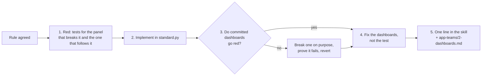

# Platform: extend the dashboard standard

← [Docs](../README.md) · [setup](setup.md) · [operate](operate.md) · design: [ADR 0004](../decisions/0004-dashboards-as-code.md)

App teams only touch `<team>/*.py`. This page is for whoever owns the rest of `platform-tools/grafana/dashboards/`.

| File | What it is | Who changes it |
|---|---|---|
| `standard.py` | Layout, filters, helpers, units, colours, house rules (`check()`) | Platform, test-first |
| `build.py` | `<team>/<name>.py` → `.json` + `kustomization.yaml` | Platform |
| `test_standard.py` | Behaviour tests; CI gate 1 | Platform |
| `metrics-allowlist.yaml` | Extra platform series forwarded to the hub | Teams propose, platform approves |
| `acm_builtin.py` → `acm-builtin.md` | Snapshot of ACM's built-in dashboards, read offline | Platform, after ACM upgrades |
| `check-queries.sh` | Runs a dashboard's queries on the hub's Thanos | Platform, with hub access |
| `pyproject.toml`, `uv.lock` | Pinned SDK and pytest | Platform |
| `.github/workflows/dashboards.yaml` | CI: tests pass, build changes no file | Platform |

## A new rule or helper is test-first

## Tests: behaviour, not config
| Test | Don't test |
|---|---|
| where a node name lands in a group | threshold numbers, colour names |
| a Deployment pod's workload drops its ReplicaSet hash | units, descriptions |
| `per_pod` follows every filter | the exact PromQL string |
| every line fills the width, at most 4 graphs per line | a snapshot of the JSON |
| a fixed `[5m]` in a graph fails the build | |
| `build.py` is repeatable, and removes the JSON of a deleted dashboard | |

- **PromQL helpers:** evaluate their regex or label logic in Python (`group_of`, `workload_of`), on real-looking inputs and edge cases.
- **Committed dashboards:** `test_every_committed_dashboard_builds` re-applies every rule to every team's dashboard.

## Housekeeping
- **SDK bump:** edit `pyproject.toml`, run `uv lock`, `uv run pytest` and `uv run build.py`, then commit the JSON.
- **Schema:** stay on the classic `dashboard.Dashboard`; ACM's loader can't load v2 (ADR 0004).
- **ACM upgrade:** run `python3 acm_builtin.py` (needs hub access) and commit `acm-builtin.md`.
- **Allowlist request:** check the series count first, since every series is stored on the hub.
- **Check real data:** `./check-queries.sh <team>/<name>.json` (needs hub access).
