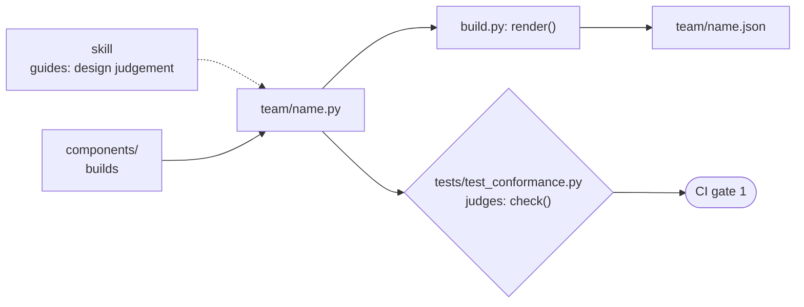
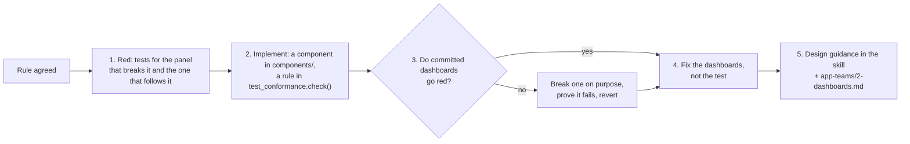

# Platform: extend the component library and the golden path

← [Docs](../README.md) · [setup](setup.md) · [operate](operate.md) · design: [ADR 0005](../decisions/0005-dashboards-as-code.md)

App teams only touch `<team>/*.py`. This page is for whoever owns the rest of `platform-tools/grafana/dashboards/`.

| File | What it is | Who changes it |
|---|---|---|
| `components/` | Component library: builds, never judges. Public API is `__all__` in `__init__.py` | Platform, test-first |
| `build.py` | `<team>/<name>.py` → `render()` → `.json` + `kustomization.yaml` | Platform |
| `tests/test_<module>.py` | Component behaviour, one file per `components/` module, plus `test_build.py` | Platform |
| `tests/test_conformance.py` | Golden-path rules (`check()`), run on every team's dashboard; CI gate 1 | Platform, test-first |
| `tests/helpers.py` | `ok()`, `page()`, `render()`, `ext()`, `panels()` shared by the tests | Platform |
| `.claude/skills/grafana-dashboard/` | Design language and judgement; links to `check()`, never restates it | Platform |
| `metrics-allowlist.yaml` | Extra platform series forwarded to the hub | Teams propose, platform approves |
| `acm_builtin.py` → `acm-builtin.md` | Snapshot of ACM's built-in dashboards, read offline | Platform, after ACM upgrades |
| `check-queries.sh` | Runs a dashboard's queries on the hub's Thanos | Platform, with hub access |
| `pyproject.toml`, `uv.lock` | Pinned SDK and pytest | Platform |
| `.github/workflows/dashboards.yaml` | CI: tests pass, build changes no file | Platform |

| Module | Holds |
|---|---|
| `queries.py` | Filters (`C`, `APP`, `SCOPE`), `per_pod`, `per_node`, node groups, `ratio`, `peak`, granularity (`STEP`, `RATE`, `RANGE`, `SIZING`) |
| `units.py` | Unit constants and threshold sets |
| `panels.py` | `tile`, `graph`, `grid`, `query`, quadrant `header` |
| `links.py` | `builtin`/`builtins` (reads `acm-builtin.md`), `drill`, `SELF` |
| `layout.py` | `vitals`, `golden_signals`, `extension`, the standard RED + saturation panels (`STANDARD_TITLES`), `WIDTH`, `MAX_PER_LINE`, `MAX_TEAM_TILES` |
| `page.py` | `dashboard`, the five `FILTERS` |

## A new component or rule is test-first

## Tests: behaviour, not config
| Test | Don't test |
|---|---|
| where a node name lands in a group | threshold numbers, colour names |
| a Deployment pod's workload drops its ReplicaSet hash | units, descriptions |
| `per_pod` follows every filter | the exact PromQL string |
| every line fills the width, at most 4 graphs per line | a snapshot of the JSON |
| a fixed `[5m]` in a graph fails conformance | |
| `build.py` is repeatable, and removes the JSON of a deleted dashboard | |

- **PromQL helpers:** evaluate their regex or label logic in Python (`group_of`, `workload_of`), on real-looking inputs and edge cases.
- **Two kinds of test, two jobs:**

  | Tests | Answers | Example |
  |---|---|---|
  | `tests/test_<module>.py` | Does the component build what it promises? | `test_layout.py`: `golden_signals` puts Latency left of Traffic |
  | `tests/test_conformance.py` | Does each team's dashboard follow the golden path? | `test_team_dashboard_conforms[starforge/platform_health.py]` |
- **A new component** goes in the `components/` module for its concern, is exported in `__all__`, and gets tests in the matching `tests/test_<module>.py`. Split a module only when it outgrows a screen.
- **A new rule** goes in `test_conformance.check()`, with one test it fails and one it passes (`ext(...)` renders a panel on a conforming page). `components/` stays a library; `build.py` writes without checking; CI gate 1 is the enforcement.
- **Team files see only `__all__`:** the SDK (`db`, `dm`, ...) isn't exported, so teams can't bypass the components.
- **Committed dashboards:** `test_team_dashboard_conforms` is parametrised over `build.sources()`, so a new team's `.py` is checked with no test change.
- **Partial pages in tests:** `page()` fills in the required System Vitals and Golden Signals (standard panels only), and `panels()` skips the standard panels.

## Housekeeping
- **SDK bump:** edit `pyproject.toml`, run `uv lock`, `uv run pytest` and `uv run build.py`, then commit the JSON.
- **Schema:** stay on the classic `dashboard.Dashboard`; ACM's loader can't load v2 (ADR 0005).
- **ACM upgrade:** run `python3 acm_builtin.py` (needs hub access) and commit `acm-builtin.md`.
- **Allowlist request:** check the series count first, since every series is stored on the hub.
- **Check real data:** `./check-queries.sh <team>/<name>.json` (needs hub access).
