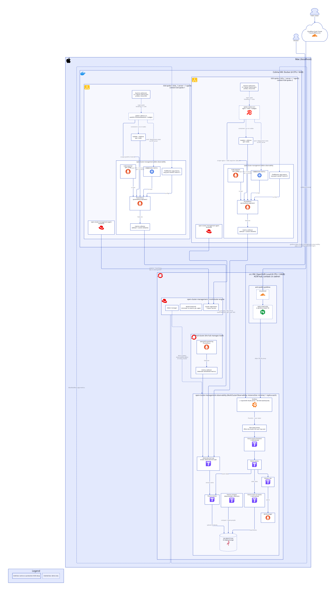
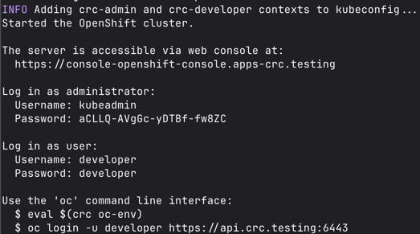

# Platform: set up the POC

← [Docs](../README.md) · then [operate](operate.md) · architecture: [system](../architecture/README.md#system)



- **Hub:** crc (OpenShift Local) runs ACM and its observability stack: Thanos, Silo (S3), Grafana.
- **Spokes:** two k3d (k3s) clusters in Colima Docker, imported into ACM. Each pushes metrics to the hub every 30s.
- **Order:** tools → crc + ACM (`install.sh`) → spokes (`spokes.sh`) → dashboards (synced by the existing ArgoCD; locally `oc apply -k platform-tools/grafana/dashboards`).

## Tools required
| Tool | For | Install |
|---|---|---|
| `crc` | OpenShift Local, the ACM hub | Red Hat's installer, steps 1-3 below |
| `oc` | Talking to all 3 clusters, hub and spokes. No need for `kubectl` | Ships with crc, step 9 below |
| Docker | Runs the k3s spoke nodes as containers. Any Docker works; this guide uses [Colima](https://github.com/abiosoft/colima) | `brew install colima docker` |
| `k3d` | Creates the k3s spoke clusters | `brew install k3d` |
| `uv` | Generates Grafana dashboards from Python ([ADR 0004](../decisions/0004-dashboards-as-code.md)) | `brew install uv` |

The scripts also use `python3` and `base64`, and the metrics query below uses `curl`. All come with macOS (`python3` via the Xcode command line tools).

## OpenShift Local + ACM
1. Go to https://console.redhat.com/openshift/create/local (create account and login)
2. Click `Download Openshift Local`
3. Go through installation process (no homebrew alternative it seems)
4. Test if `crc` is installed correctly: `which crc`
5. `crc setup`
6. `crc start`
7. After the cluster is setup, the CLI prints out some lines. Just record it somewhere



8. Access the web portal: https://console-openshift-console.apps-crc.testing
9. Get `oc` on your PATH: `eval $(crc oc-env)` (add it to `~/.zshrc` to keep it across shells)
10. Verify `oc` works: `oc login -u developer https://api.crc.testing:6443`
11. Enable cluster monitoring: `crc config set enable-cluster-monitoring true`
12. Adjust cpu limits: `crc config set cpus 6`.
13. Adjust memory limits: `crc config set memory 24576`. Enough for ACM and Observability because the install trims unused ACM features (see [Trimmed ACM features](#trimmed-acm-features)) and sizes Observability down.
14. Adjust disk size: `crc config set disk-size 100`. The default 31GB is too small for ACM (see [Troubleshooting](operate.md#troubleshooting)). The disk can only grow, not shrink.

    Budget for the whole setup (crc hub + the [spoke clusters](#spoke-clusters) in Colima), sized for a 14-core / 48GB Mac:

    | VM | CPUs | Memory | Disk |
    |---|---|---|---|
    | crc (ACM hub + Observability) | 6 | 24GB | 100GB |
    | Colima (2 k3s spokes, 2 nodes each) | 4 | 6GB | 20GB |
    | Left for macOS | 4 | 18GB | |

    Both disks are sparse: they take only what's used, but can grow to the full size. Keep enough free space on the Mac (`df -h /`) for that, or crc hits `DiskPressure`. `crc status` shows real usage; with ACM and Observability it's about 18 of 24GB RAM and 50GB disk. On a smaller Mac, lower crc's memory last; Observability needs it.
15. Restart cluster to get the updated limits: `crc stop`, `crc start`.
16. Verify that limits are updated: `crc config view`
17. Verify that Prometheus is installed: `oc get pods -n openshift-monitoring | grep prometheus`
18. (Only if behind Cloudflare WARP / Zero Trust) Trust the Cloudflare CA in the cluster, otherwise image pulls from `registry.redhat.io` fail (see [Troubleshooting](operate.md#troubleshooting)).
    - Check: `echo | openssl s_client -connect registry.redhat.io:443 2>/dev/null | openssl x509 -noout -issuer` shows `Gateway CA - Cloudflare Managed G1`
    - Log in as admin: `oc login -u kubeadmin https://api.crc.testing:6443`
    - Add the CA to crc's existing `registry-certs` configmap (don't replace it, it holds the internal registry's cert). Point `CA` at wherever your Cloudflare root cert lives:
      ```
      CA=~/.config/cloudflare/Cloudflare_CA.pem
      oc set data cm/registry-certs -n openshift-config \
        --from-file=registry.redhat.io=$CA \
        --from-file=quay.io=$CA \
        --from-file=registry.connect.redhat.com=$CA
      ```
    - Wait 1-2 min for the node to pick it up.
19. Install ACM and ACM Observability: `./platform-tools/acm/install/install.sh` (takes ~20-30 min, safe to re-run). It installs:
    - the ACM operator and MultiClusterHub
    - [Silo](https://github.com/pgsty/silo) (community MinIO fork) as in-cluster S3 for Thanos
    - MultiClusterObservability, sized down to fit one crc node
20. Open Grafana: https://grafana-open-cluster-management-observability.apps-crc.testing (see [ACM Grafana](operate.md#acm-grafana))
21. Verify metrics are flowing: `oc get pods -n open-cluster-management-observability` shows everything Running, and the ACM dashboards in Grafana show `local-cluster`.

## Checking metrics
- Single cluster, built-in Prometheus: console → **Observe → Dashboards** / **Observe → Metrics**.
- All managed clusters, via ACM: Grafana link above, **Dashboards → ACM**.
- From the CLI:
  ```
  H=$(oc get route rbac-query-proxy -n open-cluster-management-observability -o jsonpath='{.spec.host}')
  curl -sk -H "Authorization: Bearer $(oc whoami -t)" "https://$H/api/v1/query" \
    --data-urlencode 'query=count by (cluster) (up)'
  ```

## Spoke clusters
crc is the only OpenShift cluster (the ACM hub). The spokes are real, lightweight [k3s](https://k3s.io) clusters run by [k3d](https://k3d.io) in Docker, imported into ACM like any other cluster.

1. Install Docker and k3d (see [Tools required](#tools-required))
2. Start Docker with room for the spokes: `colima start --cpu 4 --memory 6 --disk 20` (see the [budget](#openshift-local--acm) under step 14). Colima's disk can't shrink, so if `colima list` shows `Broken` or a bigger disk (the existing VM has 100GiB), run `colima delete` first
3. `./platform-tools/acm/spoke-clusters/spokes.sh` creates one spoke per `spoke-*/` directory (safe to re-run). Behind Cloudflare WARP, prefix it with the same `CA=...` as step 18.
4. `oc get managedcluster` shows `spoke-1`, `spoke-2` as `JOINED` and `AVAILABLE`. Metrics show up in Grafana a few minutes later.

What you get:
- Each `spoke-N` has 2 nodes (1 server, 1 agent), with traefik, servicelb and metrics-server turned off to save memory. All spokes share `k3d-cluster.yaml`.
- ACM installs its observability addon on each one (`open-cluster-management-addon-observability`): a small Prometheus, kube-state-metrics and node-exporter, pushing to the hub every 30s (`interval` in `04-observability.yaml`; ACM's default is 5 min).
- Sample apps in a `spoke-N-demo` namespace, so each cluster's graphs look different and the namespace says which cluster it's on: `spoke-1` runs podinfo (frontend → backend), `spoke-2` runs nginx and redis. Both have a tiny load generator. Edit `spoke-N/apps.yaml` to change them; `spoke-N/kustomization.yaml` puts them in the namespace.
- Every pod's own metrics: any container port named `metrics`, in any namespace, is scraped and sent to the hub (`metrics/manifestwork.yaml`, delivered from the hub). Kyverno rejects pods without one in `golden-path.level=L1` namespaces (`kyverno/`). How app teams onboard: [app teams → metrics](../app-teams/1-metrics.md). `./platform-tools/acm/spoke-clusters/check-metrics.sh` checks every running spoke pod has metrics on the hub.
- To add a spoke, copy `spoke-2/` to `spoke-3/`, replace `spoke-2` with `spoke-3` in its files, and re-run. A third spoke needs more inotify watchers in Colima than the default, or k3s fails with `too many open files`: `colima ssh -- sudo sysctl fs.inotify.max_user_instances=1024`. `./spokes.sh down` removes them all, from ACM and k3d.

How they reach the hub: crc's `api.crc.testing` and `*.apps-crc.testing` resolve to the Mac's `127.0.0.1`. The script maps those names, inside each k3s cluster, to Docker's host gateway, which is the Mac. The spokes pull ACM's agent images from `registry.redhat.io` using crc's own pull secret.

## Trimmed ACM features
To fit a small crc VM, `02-multiclusterhub.yaml` and `install.sh` turn off ACM features this repo doesn't use, and run 1 replica of each component:
- ACM: Search, Applications, Governance, Submariner, VolSync, Insights
- MultiClusterEngine: Hive, Assisted Installer, Discovery, HyperShift (cluster provisioning; importing existing clusters still works)

To bring one back, set its `enabled` to `true` (in `02-multiclusterhub.yaml`, or with `oc edit mce multiclusterengine`).

