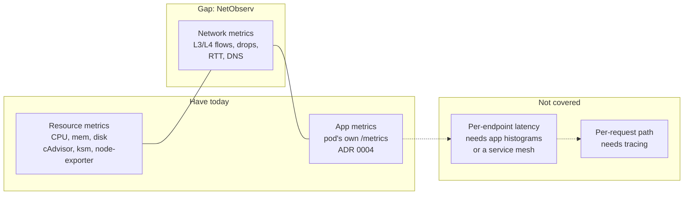
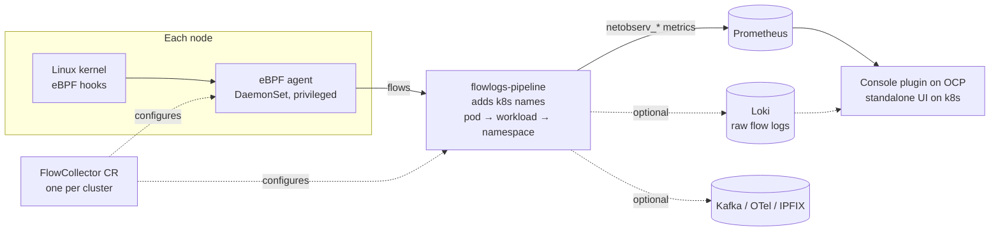
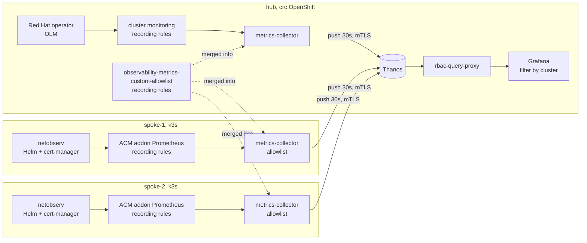
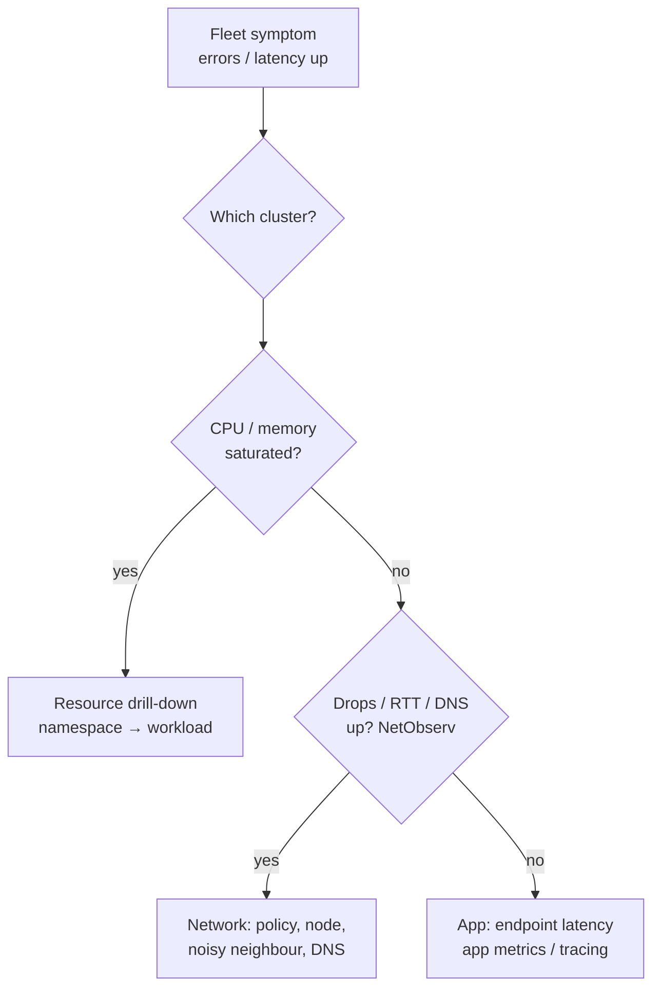

# Network Observability Operator (NetObserv)

- **Status:** Research, 2026-10-29. Nothing installed yet.
- **Scope:** what it is, the value it brings to the hub-and-spoke POC, the cost, and the trade-offs.

## TL;DR
- eBPF-based **L3/L4 flow metrics**: who talks to whom, bytes, packets, drops, TCP RTT, DNS latency, labelled with Kubernetes names.
- Fills the gap between **resource metrics** (what we have) and **app metrics** (golden path): *"CPU is fine, so is it the network?"*
- **No native multi-cluster support.** Multi-cluster = netobserv on every cluster → recording rules → ACM allowlist → hub Thanos → Grafana. This pattern comes from community examples, not a supported product.
- **Doesn't see HTTP.** It can't tell you which API endpoint is slow.
- Worth it if network problems (timeouts, DNS, policies, noisy neighbours) are part of on-call pain. Otherwise defer it.

## Where it fits

| Question | Resource | NetObserv | App metrics | Tracing |
|---|---|---|---|---|
| Is a pod starved of CPU or memory? | ✅ | | | |
| Is the network dropping or delaying traffic? | | ✅ | | |
| Which workload calls which, and how much? | | ✅ | | ✅ |
| Is DNS slow or failing? | | ✅ | | |
| Which API endpoint is slow? | | ❌ | ✅ | ✅ |
| Why is this one request slow? | | ❌ | | ✅ |

## How it works (one cluster)

- **Agent** reads packets in the kernel. No sidecars, no app changes.
- **flowlogs-pipeline (FLP)** turns IPs into workload and namespace names and exports metrics.
- **Deployment models:**
  - `Direct`: FLP runs as a DaemonSet next to each agent. Upstream recommends it for clusters under 15 nodes.
  - `Service` (default): FLP runs as a Deployment, with TLS from the agents.
  - `Kafka`: you run Kafka.
- **Optional features:** packet drops, TCP RTT, DNS tracking and network policy events. Drops need privileged mode.
- **Version:** 2.0, upstream 2.0.1-community (2026-09).

## Multi-cluster with ACM

- **Native multi-cluster support:** only `spec.processor.multiClusterDeployment` + `clusterName`, which adds a `K8S_ClusterName` label. There's no fleet UI.
- **Recording rules, not raw series:** cardinality drops from N² (src × dst workload pairs) to 2N.
- **Building blocks:** `netobserv_workload_{ingress,egress}_{bytes,packets}_total`, grouped to namespace and workload level.
- **Flow logs across the fleet:** central Loki or Kafka is possible, but there's no official multi-cluster flow-log guide.
- **ACM deployment:**
  - Upstream ACM Policy samples install netobserv on clusters labelled `netobserv=true`. They target netobserv 1.4 (`v1beta1`), so they're stale.
  - Helm per spoke is simpler.

### Metrics per drill-down level
| Level | Source | Group by |
|---|---|---|
| Fleet / cluster | `workload_*` summed | `cluster` |
| Namespace | `workload_*`, `namespace_*` | `{Src,Dst}K8S_Namespace` |
| Node | `node_*` | `{Src,Dst}K8S_HostName` |
| Workload | `workload_*` | `K8S_OwnerName`, `K8S_OwnerType` |
| Extras | `*_drop_*`, `*_rtt_seconds`, `*_dns_latency_seconds` | any of the above |

- Custom counters and histograms: the `FlowMetric` CRD, created in the `netobserv` namespace.

## Business value
| README challenge | Question it answers |
|---|---|
| **Slow incident response** | Is it the network or the app? Which workload is the source? Did a deploy or NetworkPolicy break connectivity? Is one cluster different from the rest? |
| **Underused tooling** | Who uses the most network? How much traffic leaves the cluster (egress cost)? Which services get no traffic (decommission candidates)? |
| **No shared practice** | What's normal per cluster? A fixed "after CPU/memory, check network" step in the runbook |
| *Bonus: security* | Unexpected traffic between namespaces or to external addresses. Evidence that tenants are isolated |

### Where it slots into triage

## Cost and complexity
| Item | Hub (crc, OCP) | Spoke (k3s) |
|---|---|---|
| Install | OLM operator, supported | Helm chart + **cert-manager + trust-manager** |
| Privileges | privileged DaemonSet | privileged required (k3s/kind fail without it) |
| Kernel | 5.8+ (ok) | 5.8+ (k3d nodes: 6.8, ok) |
| Default requests per node | agent 100m / 50Mi, FLP 100m / 100Mi | same |
| Default memory limits | agent 800Mi, FLP 800Mi | same |
| UI | console plugin (topology) | standalone UI, port-forward only |
| Metrics to hub | user-workload allowlist (OCP-specific, unverified) | ServiceMonitor + RBAC in the addon namespace, likely (unverified) |

- **Without Loki:** Red Hat says memory drops 20-65% and CPU 10-30%.
- **Hub headroom:** crc uses ~16 of 24GB today. Metrics-only fits; Loki is a stretch.
- **Sizing:** Red Hat's smallest documented size is 10 nodes. I found nothing official for a laptop.

## Trade-offs
### Loki or not
| | Metrics only | + Loki |
|---|---|---|
| Fleet, cluster, namespace, workload trends | ✅ | ✅ |
| Packet-drop statistics | metrics ✅, Red Hat's table says drop details need Loki | ✅ |
| Search individual flows ("what happened at 14:02?") | ❌ | ✅ |
| Topology with history | basic | ✅ |
| Footprint | small | +1 Loki per cluster or a central one, plus storage |
| Fit for this POC | ✅ | ❌ (crc RAM) |

### Sampling rate (`spec.agent.ebpf.sampling`)
| Rate | Accuracy | Cost | Use |
|---|---|---|---|
| 1 (every packet) | exact | highest CPU | lab, low traffic |
| 50 (default) | statistical | low | production |

### Deployment model
| | Direct | Service | Kafka |
|---|---|---|---|
| Parts | agent + FLP per node | agent → FLP Deployment | agent → Kafka → FLP |
| TLS between agent and FLP | none (localhost) | yes | yes |
| Scale | < 15 nodes | medium | large, resilient |

### Delivery to spokes
| | Helm in `spokes.sh` | ACM Policy | ManifestWork |
|---|---|---|---|
| Effort | low | rewrite stale v1beta1 samples | render and ship a large chart |
| GitOps / drift repair | ❌ | ✅ | ✅ |
| Matches repo | Kyverno is installed this way | | `app-metrics` is delivered this way |

### Adopt or not
| Adopt if | Skip or defer if |
|---|---|
| Timeouts, DNS or policy problems show up in incidents | Incidents are mostly CPU/memory starvation |
| You need to know who calls whom between teams or namespaces | You mainly need per-endpoint latency (do app histograms first) |
| Egress cost or tenant isolation matters | You can't run a privileged DaemonSet on clusters |

## Risks and unknowns
- **Multi-cluster is hand-assembled:** the allowlist, recording rules and dashboards are ours to maintain. The ACM examples are community-maintained.
- **Not tested on k3s with ACM:** whether ACM's addon Prometheus scrapes FLP without an extra ServiceMonitor and RBAC.
- **Hub metrics path:** on OpenShift, netobserv metrics go to user-workload monitoring and may need `uwl_metrics_list.yaml`.
- **Cardinality:** upstream warns that `workload_*` series are high-cardinality. Forward recording rules only.
- **Security review:** a privileged eBPF DaemonSet on every node.

## Proposed next step (not started)
- Hub: Red Hat operator via OLM.
- Spokes: upstream Helm chart from `spokes.sh`.
- FlowCollector settings on every cluster:
  - Direct mode, no Loki, sampling 1;
  - drops, RTT and DNS on.
- One hub-wide `observability-metrics-custom-allowlist` with namespace- and workload-level recording rules.
- A verify script: `local-cluster`, `spoke-1` and `spoke-2` must all return netobserv series.
- Dashboards: out of scope for now.

## Sources
- Operator, FlowCollector spec, metrics and TLS docs: https://github.com/netobserv/netobserv-operator (`docs/FlowCollector.md`, `docs/Metrics.md`, `docs/TLS.md`)
- Releases: https://github.com/netobserv/netobserv-operator/releases
- Red Hat docs (OCP 4.22): https://docs.redhat.com/en/documentation/openshift_container_platform/4.22/html-single/network_observability/index
- Without Loki: https://netobserv.io/posts/light-weight-network-observability-operator-without-loki/
- NetObserv in RHACM: https://netobserv.io/posts/leveraging-netobserv-metrics-in-rhacm/
- ACM examples (allowlist, dashboards, policies): https://github.com/netobserv/documents/tree/main/examples/ACM
- FlowMetric samples: https://github.com/netobserv/netobserv-operator/tree/main/config/samples/flowmetrics
