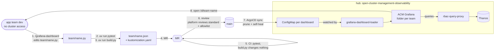

# Dashboards as code: from Python to ACM Grafana

Why Python, the SDK and uv: [ADR 0004](../../../doc/decisions/0004-dashboards-as-code.md). How to write a dashboard: the `grafana-dashboard` skill ([SKILL.md](../../../.claude/skills/grafana-dashboard/SKILL.md)).

## Layout
```
dashboards/
  standard.py            the design standard: layout, filters, helpers, colours, house rules
  build.py               builds every <team>/<name>.py, writes kustomization.yaml
  test_standard.py       behaviour tests for standard.py and build.py
  CONTRIBUTING.md        how to change the standard: test-first rules
  pyproject.toml         pinned dependencies (SDK, pytest); uv.lock locks them
  check-queries.sh       runs a dashboard's queries against the hub (platform/CI, needs hub access)
  acm_builtin.py         snapshots ACM's built-in dashboards into acm-builtin.md (needs the hub)
  acm-builtin.md         that snapshot: read it offline before building a panel
  metrics-allowlist.yaml extra series forwarded to the hub
  kustomization.yaml     generated by build.py; what ArgoCD syncs
  <team>/                one folder per team = one Grafana folder
    <name>.py            defines `dashboard = dashboard(...)`
    <name>.json          generated, committed
```
| From the path `starforge/platform_health.py` | Value |
|---|---|
| Grafana uid, URL | `starforge-platform-health`, `/d/starforge-platform-health` |
| Grafana folder | `starforge` |
| ConfigMap | `grafana-dashboard-starforge-platform-health` |
| Tags | `golden-path`, `starforge`, plus the dashboard's own |

## Flow: one central repo, GitOps to the hub
Apps run on spokes, but every team's dashboard lives in **this repo**, because ACM Grafana runs on the hub. GitOps (ArgoCD) is already set up on the hub; [`../gitops/dashboards-application.yaml`](../gitops/dashboards-application.yaml) points it at this directory.



## Steps
| # | Who | Where | Command / action | Fails when |
|---|---|---|---|---|
| 1 | App team dev | laptop | `/grafana-dashboard <question>` in Claude, or edit `<team>/<name>.py`. Reads `acm-builtin.md`, so no hub needed | — |
| 2 | App team dev | laptop | `uv run pytest`: behaviour tests, and every dashboard builds | A helper's behaviour broke, or a house rule fails |
| 3 | App team dev | laptop | `uv run build.py`: writes `.json` and `kustomization.yaml` | Type error or house rule (width, filters, units, windows, built-in links) |
| 4 | App team dev | GitHub | Open an MR with the `.py` and generated `.json` | — |
| 5 | CI | [`.github/workflows/dashboards.yaml`](../../../.github/workflows/dashboards.yaml) | Gate 1 `uv run pytest`; gate 2 `uv run build.py`, then fail if git sees any changed, new or deleted file | Gate 1: the standard is broken. Gate 2: a `.py` without its committed `.json`, a hand-edited `.json`, a stale `kustomization.yaml`, or a `.json` left after its `.py` was deleted |
| 6 | Reviewers | GitHub | The team reviews its dashboard; the platform team reviews any change to `standard.py`, `build.py` or `metrics-allowlist.yaml` | — |
| 7 | ArgoCD | hub | Syncs `main` with prune and self-heal: one ConfigMap per dashboard, folder from the team name | Sync errors show in Argo, on `acm-grafana-dashboards` |
| 8 | Automatic, ~10s | hub | The loader creates/updates by `uid` in the team's folder, and deletes removed dashboards and empty folders | Loader logs: `oc logs deploy/observability-grafana -c grafana-dashboard-loader -n open-cluster-management-observability` |
| — | Platform team | hub | Optional: `./check-queries.sh <team>/<name>.json` runs the real queries. Needs hub read access | `ERROR`: PromQL doesn't parse. `0 series`: metric missing, or nothing to show |

## What needs the platform team
- **A metric that isn't on the hub yet:** the team edits `metrics-allowlist.yaml` in the MR, and platform approves it, because it costs hub storage.
- **A change to the standard** (`standard.py`): a helper the team needs, or a rule. See [CONTRIBUTING.md](CONTRIBUTING.md).
- **Refreshing `acm-builtin.md`** after an ACM upgrade (`python3 acm_builtin.py`).

## Rules of the road
- **Edit the `.py`.** Never edit the `.json` or `kustomization.yaml` (CI fails), or the Grafana UI (Argo and the loader revert it).
- **Renaming or moving a file changes its uid**, which means a new URL, and links to the old one break. Keep names stable.
- **New team:** create `<team>/`, add a `<name>.py`, build and open an MR. The folder appears in Grafana after the sync.
- **Remove a dashboard:** delete its `.py` and `.json`, rebuild, and merge. Argo prunes the ConfigMap, and the loader removes the dashboard.
- **Team dashboards open on their namespace:** `dashboard(..., scope={"namespace": "<ns>"})`. Users can still widen the filters.

## Page structure (enforced by `standard.py`)
```
System Vitals    tiles, one full-width line
Golden Signals   Latency | Traffic
                 Errors  | Saturation
Extensions       collapsed rows, one per question
Filters          cluster → node → namespace → workload → pod, on every panel
```
