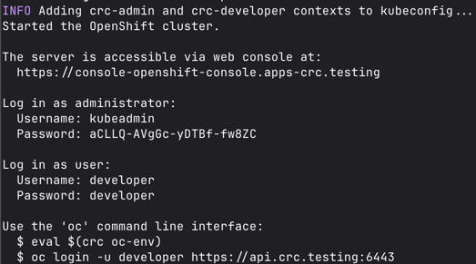

# Tools required
| Tool | For | Install |
|---|---|---|
| `crc` | OpenShift Local, the ACM hub | Red Hat's installer, steps 1-3 below |
| `oc` | Talking to all 3 clusters, hub and spokes. No need for `kubectl` | Ships with crc, step 9 below |
| Docker | Runs the k3s spoke nodes as containers. Any Docker works; this guide uses [Colima](https://github.com/abiosoft/colima) | `brew install colima docker` |
| `k3d` | Creates the k3s spoke clusters | `brew install k3d` |

The scripts also use `python3` and `base64`, and the metrics query below uses `curl`. All come with macOS (`python3` via the Xcode command line tools).

# Openshift-local setup
1. Go to https://console.redhat.com/openshift/create/local (create account and login)
2. Click `Download Openshift Local`
3. Go through installation process (no homebrew alternative it seems)
4. Test if `crc` is installed correctly: `which crc`
5. `crc setup`
6. `crc start`
7. After the cluster is setup, the CLI prints out some lines. Just record it somewhere



8. Access the web portal: https://console-openshift-console.apps-crc.testing
9. Get `oc` on your PATH: `eval $(crc oc-env)` (add it to `~/.zshrc` to keep it across shells)
10. Verify `oc` works: `oc login -u developer https://api.crc.testing:6443`
11. Enable cluster monitoring: `crc config set enable-cluster-monitoring true`
12. Adjust cpu limits: `crc config set cpus 6`.
13. Adjust memory limits: `crc config set memory 24576`. Enough for ACM and Observability because the install trims unused ACM features (see [Trimmed ACM features](#trimmed-acm-features)) and sizes Observability down.
14. Adjust disk size: `crc config set disk-size 100`. The default 31GB is too small for ACM (see [Troubleshooting](#troubleshooting)). The disk can only grow, not shrink.

    Budget for the whole setup (crc hub + the [spoke clusters](#spoke-clusters) in Colima), sized for a 14-core / 48GB Mac:

    | VM | CPUs | Memory | Disk |
    |---|---|---|---|
    | crc (ACM hub + Observability) | 6 | 24GB | 100GB |
    | Colima (2 k3s spokes, 2 nodes each) | 4 | 6GB | 20GB |
    | Left for macOS | 4 | 18GB | |

    Both disks are sparse: they take only what's used, but can grow to the full size. Keep enough free space on the Mac (`df -h /`) for that, or crc hits `DiskPressure`. `crc status` shows real usage; with ACM and Observability it's about 18 of 24GB RAM and 50GB disk. On a smaller Mac, lower crc's memory last; Observability needs it.
15. Restart cluster to get the updated limits: `crc stop`, `crc start`.
16. Verify that limits are updated: `crc config view`
17. Verify that Prometheus is installed: `oc get pods -n openshift-monitoring | grep prometheus`
18. (Only if behind Cloudflare WARP / Zero Trust) Trust the Cloudflare CA in the cluster, otherwise image pulls from `registry.redhat.io` fail (see [Troubleshooting](#troubleshooting)).
    - Check: `echo | openssl s_client -connect registry.redhat.io:443 2>/dev/null | openssl x509 -noout -issuer` shows `Gateway CA - Cloudflare Managed G1`
    - Log in as admin: `oc login -u kubeadmin https://api.crc.testing:6443`
    - Add the CA to crc's existing `registry-certs` configmap (don't replace it, it holds the internal registry's cert). Point `CA` at wherever your Cloudflare root cert lives:
      ```
      CA=~/.config/cloudflare/Cloudflare_CA.pem
      oc set data cm/registry-certs -n openshift-config \
        --from-file=registry.redhat.io=$CA \
        --from-file=quay.io=$CA \
        --from-file=registry.connect.redhat.com=$CA
      ```
    - Wait 1-2 min for the node to pick it up.
19. Install ACM and ACM Observability: `./platform-tools/acm/install/install.sh` (takes ~20-30 min, safe to re-run). It installs:
    - the ACM operator and MultiClusterHub
    - [Silo](https://github.com/pgsty/silo) (community MinIO fork) as in-cluster S3 for Thanos
    - MultiClusterObservability, sized down to fit one crc node
20. Open Grafana: https://grafana-open-cluster-management-observability.apps-crc.testing (see [Grafana](#grafana))
21. Verify metrics are flowing: `oc get pods -n open-cluster-management-observability` shows everything Running, and the ACM dashboards in Grafana show `local-cluster`.

## Checking metrics
- Single cluster, built-in Prometheus: console → **Observe → Dashboards** / **Observe → Metrics**.
- All managed clusters, via ACM: Grafana link above, **Dashboards → ACM**.
- From the CLI:
  ```
  H=$(oc get route rbac-query-proxy -n open-cluster-management-observability -o jsonpath='{.spec.host}')
  curl -sk -H "Authorization: Bearer $(oc whoami -t)" "https://$H/api/v1/query" \
    --data-urlencode 'query=count by (cluster) (up)'
  ```

## Grafana

### Logging in
1. Open https://grafana-open-cluster-management-observability.apps-crc.testing. The first page is a 403 "Log In" page; that's OpenShift's login in front of Grafana, not an error.
2. Click **Log in with OpenShift** and choose **kube:admin**. The password is the one `crc start` printed; `crc console --credentials` shows it again.
3. You land on **ACM - Clusters Overview**. The other dashboards are under **Dashboards → ACM**.

The ACM console also links to Grafana from **Infrastructure → Clusters**.

### How it's provisioned
Nothing in this repo configures Grafana. The ACM observability operator creates it from the `MultiClusterObservability` resource (`platform-tools/acm/install/04-observability.yaml`) and owns the `observability-grafana` deployment in `open-cluster-management-observability`. The pod runs three containers:

| Container | Role |
|---|---|
| `grafana` | Red Hat's Grafana build. Settings come from the `grafana-config` secret. |
| `grafana-dashboard-loader` | Loads the configmaps named `grafana-dashboard-*` into Grafana. ACM ships about 58 of them. |
| `grafana-proxy` | OpenShift OAuth proxy. Only users allowed to list `projects` get in. |

Data sources come from the `grafana-datasources` secret. Both (`Observatorium`, the default, and `Observatorium-Dynamic`) point at `rbac-query-proxy`, which sits in front of Thanos and filters by user: a user only sees metrics for clusters whose namespaces they can access. `kubeadmin` sees everything.

### Customizing
- **Custom dashboards:** create a configmap in `open-cluster-management-observability` labelled `grafana-custom-dashboard: "true"`, holding the dashboard JSON. The loader picks it up. This is the supported way, and it keeps dashboards in git.
- **Editing in the UI:** changes to ACM-shipped dashboards can be overwritten from their configmaps when the operator reconciles. Export anything you want to keep into a custom dashboard configmap.
- **Grafana settings and data sources:** these secrets are operator-managed and hand edits get reverted. Change them through the `MultiClusterObservability` resource instead.

### Sharing ACM's Grafana publicly, read-only
`./platform-tools/acm/public-access/expose.sh` publishes ACM's own Grafana through a Cloudflare Quick Tunnel and prints a `https://*.trycloudflare.com` link. It's the same Grafana, dashboards and data as the in-cluster one, so nothing drifts.
- **Anyone with the link can view every managed cluster's metrics, with no login.** They're signed in as `public-viewer`.
- **Read-only is enforced by nginx, not Grafana.** ACM's Grafana lets viewers edit, so nginx refuses every request except reads and panel queries (`POST /api/ds/query`); attempts to save or delete get a 403.
- The tunnel runs in the cluster, so nothing needs installing on your Mac and no Cloudflare account is needed. The link only works while crc is running.
- The link changes whenever the `cloudflared` pod restarts, for example after `crc stop`/`crc start`. Re-run `expose.sh` to get the new one.
- To take it down: `oc delete -f platform-tools/acm/public-access/public-grafana.yaml`

How it works: ACM's Grafana sits behind an OpenShift login proxy and trusts two headers from it, `X-Forwarded-User` (who you are) and `X-Forwarded-Access-Token` (sent on to `rbac-query-proxy`, which decides which clusters' metrics you see). The nginx pod skips that login, talks to the Grafana container directly, and sets both headers using the `grafana-viewer` service account. That account can read all namespaces, projects and ManagedClusters (`acm-public-grafana-viewer` ClusterRole), which makes the proxy return every cluster, read-only.
- Its token is short-lived and rotated by Kubernetes; nginx re-reads it every 5 min. A long-lived `service-account-token` secret doesn't work: `rbac-query-proxy` only shows those `local-cluster`.

## Spoke clusters
crc is the only OpenShift cluster (the ACM hub). The spokes are real, lightweight [k3s](https://k3s.io) clusters run by [k3d](https://k3d.io) in Docker, imported into ACM like any other cluster.

1. Install Docker and k3d (see [Tools required](#tools-required))
2. Start Docker with room for the spokes: `colima start --cpu 4 --memory 6 --disk 20` (see the [budget](#openshift-local-setup) under step 14). Colima's disk can't shrink, so if `colima list` shows `Broken` or a bigger disk (the existing VM has 100GiB), run `colima delete` first
3. `./platform-tools/acm/spoke-clusters/spokes.sh [count]` (default 2). Behind Cloudflare WARP, prefix it with the same `CA=...` as step 18.
4. `oc get managedcluster` shows `spoke-1`, `spoke-2` as `JOINED` and `AVAILABLE`. Metrics show up in Grafana a few minutes later.

What you get:
- Each `spoke-N` has 2 nodes (1 server, 1 agent), with traefik, servicelb and metrics-server turned off to save memory.
- ACM installs its observability addon on each one (`open-cluster-management-addon-observability`): a small Prometheus, kube-state-metrics and node-exporter, pushing to the hub every 30s (`interval` in `04-observability.yaml`; ACM's default is 5 min).
- Sample apps in a `spoke-N-demo` namespace, so each cluster's graphs look different and the namespace says which cluster it's on: `spoke-1` runs podinfo (frontend → backend), `spoke-2` runs nginx and redis. Both have a tiny load generator. Edit `apps/spoke-N.yaml` to change them.
- `./spokes.sh 0` removes them all, from ACM and k3d.

How they reach the hub: crc's `api.crc.testing` and `*.apps-crc.testing` resolve to the Mac's `127.0.0.1`. The script maps those names, inside each k3s cluster, to Docker's host gateway, which is the Mac. The spokes pull ACM's agent images from `registry.redhat.io` using crc's own pull secret.

### Working with the 3 clusters
All three are contexts in `~/.kube/config`: `crc-admin` (hub), `k3d-spoke-1`, `k3d-spoke-2`. Keep the current context on the hub and pass `--context` for spokes, instead of switching back and forth. Every command then says which cluster it hits, and a forgotten switch can't land a deploy on the wrong cluster.
```
oc get pods -A                                          # hub (current context)
oc --context k3d-spoke-1 get pods -n spoke-1-demo       # one spoke
for c in crc-admin k3d-spoke-1 k3d-spoke-2; do echo "== $c"; oc --context $c get nodes; done   # all
oc --context k3d-spoke-2 apply -f platform-tools/acm/spoke-clusters/apps/spoke-2.yaml   # deploy
```
- **Read-only checks across clusters:** you rarely need to log in to a spoke. The hub's Grafana and the `rbac-query-proxy` query above already show every cluster's metrics, filtered by the `cluster` label.
- **Deploying:** `oc --context <spoke> apply -f` for these demo apps. To drive spokes from the hub instead, ACM's `ManifestWork` (installed, `oc get manifestwork -A`) applies manifests to a managed cluster from its namespace on the hub. Use it only once you want the hub to own what runs where; for 2 demo spokes it's extra indirection.
- **Interactive:** [k9s](https://k9scli.io) (`brew install k9s`, `:ctx` to switch) is the easiest way to browse several clusters. If you do switch contexts, `oc config use-context crc-admin` gets you back, and `install.sh`/`spokes.sh` assume the hub is current.

## Trimmed ACM features
To fit a small crc VM, `02-multiclusterhub.yaml` and `install.sh` turn off ACM features this repo doesn't use, and run 1 replica of each component:
- ACM: Search, Applications, Governance, Submariner, VolSync, Insights
- MultiClusterEngine: Hive, Assisted Installer, Discovery, HyperShift (cluster provisioning; importing existing clusters still works)

To bring one back, set its `enabled` to `true` (in `02-multiclusterhub.yaml`, or with `oc edit mce multiclusterengine`).

## Troubleshooting

### ACM install hangs at "Waiting for ACM operator to register the MultiClusterHub CRD"
- Symptom: `oc get sub advanced-cluster-management -n open-cluster-management -o yaml` shows `BundleUnpackFailed`, and `oc get events -n openshift-marketplace | grep -i pull` shows `x509: certificate signed by unknown authority`.
- Cause: Cloudflare WARP intercepts TLS; the crc VM doesn't trust its CA.
- Fix: step 18, then clear the failed attempt and re-run the install:
  ```
  oc delete job -n openshift-marketplace --all
  oc delete sub advanced-cluster-management -n open-cluster-management
  oc delete csv -n open-cluster-management --all
  ./platform-tools/acm/install/install.sh
  ```

### ACM install times out at "Waiting for MultiClusterHub to reach Running"
- Symptom: pods in `open-cluster-management` stuck in `ImagePullBackOff` / `Error` / `ContainerStatusUnknown`; `oc get events -A --field-selector type=Warning` shows `Evicted ... low on resource: ephemeral-storage` and `DiskPressure`.
- Cause: crc VM disk is full (default 31GB).
- Fix: `crc stop && crc config set disk-size 100 && crc start`, then re-run the install.

### Observability install times out at "Waiting for MultiClusterObservability to become Ready"
- Symptom: `observability-*` pods in `open-cluster-management-observability` stuck `Pending`; their events say `Insufficient cpu` or `Insufficient memory`.
- Cause: ACM's default sizing reserves ~10 CPU cores and 2-3 replicas of every component, more than a single 6-core crc node has. `04-observability.yaml` shrinks this; if you changed it, or a node is still short, check `oc describe node crc | grep -A5 'Allocated resources'`.
- If you lower resources in `04-observability.yaml` after pods are already `Pending`, the StatefulSet won't replace them. Delete them so they come back with the new values:
  ```
  oc delete pod -n open-cluster-management-observability --field-selector=status.phase=Pending
  ```

### Object storage pod won't start
- `ImagePullBackOff` with `unauthorized` on `minio/minio`: MinIO no longer publishes free images. `03-object-storage.yaml` uses Silo instead.

### `oc: command not found`
- crc ships `oc` at `~/.crc/bin/oc/oc` but doesn't add it to PATH. Run `eval $(crc oc-env)`. `install.sh` does this itself if `oc` is missing.
